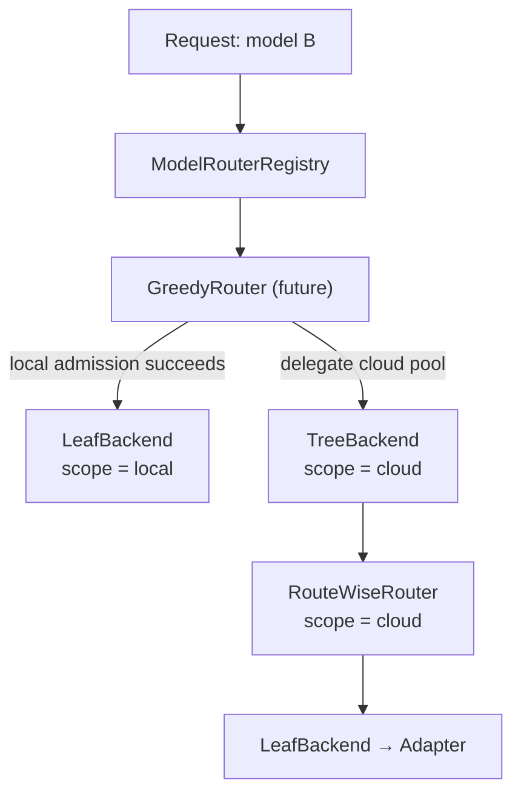

# 可组合的 Hybrid Routing 设计

状态：契约和 opt-in 接线已实现；Greedy / Nimbus、共享容量所有者和若干等价性问题尚未完成。延期项见 [Issue #1457](https://github.com/HarvardMadSys/hybridInference/issues/1457)。

## 1. 设计决定

路由算法可以替换，也可以组合。Router 负责决策和请求编排；Backend 是上层可以委托的推理能力，可以是单个 endpoint，也可以是内部带 Router 的服务池。

1. `RouterProtocol` 是唯一的公共 Router 契约。`FixedRouter`、`RouteWiseRouter` 以及未来的 Greedy / Nimbus 是它的并列实现，各自保留自己的重试、反馈和控制流程。不新建同名的 `HybridRouter` 接口。
2. 模型通过 Registry 绑定一个入口 Router。入口可以直接是 RouteWise，也可以是内部委托云端 RouteWise 的 Greedy。组合在构建时完成。
3. 算法、候选范围和组合位置分别配置。同一个 RouteWise 实现可以绑定完整候选池或只绑定 cloud 子集，不需要两套算法。
4. `LeafBackend` 是递归终点，绑定一个 Adapter 和一个 endpoint。`TreeBackend` 是路由子树的入口，把请求委托给范围受限的内部 Router。
5. “执行这个 endpoint”和“交给这个 pool”是两种显式指令。前者不能改选；后者允许子 Router 在授权范围内选路、重试和 hedging。
6. local / cloud 是部署归属，on_demand / quota / concurrency 是资源模型，两者互相独立。本地 GPU 部署在显式配置时可以是 concurrency 候选。
7. 容量按真实资源池共享。每次尝试、预留、反馈和生命周期都有唯一所有者，多包一层不能复制容量，也不能重复记账。

Fixed 和 RouteWise 的请求行为保持不变。RouteWise 的成本优化、`budget_alpha`、准入、预留、重求解、重试、hedging、学习和生命周期仍由原实现负责，不能被塞进具体的 HybridRouter、按域拆分的 Fixed 或只含 cloud 的池。组合第一版只支持一个入口 Router 加一个云端子 Router，不支持任意递归。

## 2. 对象

| 对象 | 职责 |
|---|---|
| [RouterProtocol](../../../apps/backend/routing/protocols.py) | 统一普通请求、流式、反馈和诊断入口。不要求各算法共用内部决策结构或控制循环 |
| 具体 Router | 在自己的范围内选路，组织准入、重试、hedging 和学习 |
| [RoutingBackend](../../../apps/backend/routing/backends.py) | 向上层提供可委托的推理能力和明确的范围。与 RouterProtocol 是两个独立的结构协议，不是继承关系 |
| LeafBackend | 执行已绑定的 endpoint。`config` 和调用签名都是 Adapter 的，可以放在任何执行 Adapter 的位置。不保存队列、预留、健康记录、失败样本或 `_routing` 块，这些都留在选出 endpoint 的 Router 里 |
| TreeBackend | 持有一个范围受限的内部 Router（组合，不是继承）。校验范围，传递上下文和结果，不重写内部算法 |
| LocalBackend / CloudBackend | 表达部署归属，是服务池的便捷包装。`RouteWiseCloudBackend` 是可选的兼容包装，不是 RouteWise 的归属位置 |
| Adapter | 连接、认证、协议和响应适配，不做候选池选择 |

具体类 `routing.hybrid.HybridRouter` 是“策略加后端”的一种组合实现，不是公共接口。它的 `FixedPolicy` / `BackendSelection` 是内部细节，不强加给 RouteWise。

三种容易混淆的 pool：

| 名称 | 含义 |
|---|---|
| Backend pool / scope | 可以选择哪些执行目标 |
| Resource pool | 多次调用共同消耗的容量或配额，例如一个账号的并发槽、一组 GPU 的 KV 预算 |
| RouteWise 内部预算或学习分组 | 算法统计、建模和求解的范围 |

候选池不同可以共享同一个资源池；缩小候选范围不会产生独立的物理容量。

## 3. 运行结构

当前代码中，`router: routewise` 直接返回全池 RouteWiseRouter。`router: fixed` 默认返回共享的 FixedRouter；只有混合的 fixed 模型显式设置 `router_params.hybrid_composition: true`（默认 false）时，才走具体的 HybridRouter。

两种目标拓扑：

- 全池：`RouteWise(local + cloud)`。RouteWise 在完整候选池里比较，不必先决定 local 还是 cloud。已实现。
- 分层：`Greedy(local 准入, cloud = RouteWise(cloud 范围))`。Greedy 管自建资源的本地准入，转云后把选择权交给子 RouteWise，后者的候选、fallback、hedge 和主动探测都只在 cloud 范围内。Greedy 尚未实现。

两种拓扑复用同一个 RouteWise 类，不同范围用分别构建和缓存的实例，不能在请求之间改一个活跃实例的 scope。

`FixedRouter`（普通和流式、primary 和 fallback）、`RouteWiseRouter`（决策和两条 hedge leg）以及 RouteWise 的主动延迟探测，都通过同一个 leaf 执行。选择、准入、prefill 和反馈记账仍留在原 Router。

## 4. 派发契约

| 指令 | 上层已决定 | 下层可以做 |
|---|---|---|
| `ExecuteEndpoint` | 具体 endpoint 和本次尝试的 `EndpointBinding`（已解析的 endpoint id、实际 Adapter、路由快照） | 调用该 endpoint，返回响应、流或失败 |
| `DelegatePool` | 一个明确的 pool | 子 Router 在池内选目标、准入并执行自己的流程 |

两者定义在 [dispatch.py](../../../apps/backend/routing/dispatch.py)。规则：

- 不匹配的模型、endpoint 或范围，在产生任何上游 I/O 之前被拒绝，作为组合错误处理：不计入尝试，不产生 provider 故障样本，不触发 fallback。普通和流式路径一致。
- `DelegatePool.pool_id` 必须匹配 Backend 声明的范围，并与模型、模态和调用方约束取交集。
- 范围先规范化为当前模型的 canonical endpoint 集合再比较，因为声明范围和绑定可能分别用 provider 标签和 endpoint id 表示。
- 调用方的范围在每一层转发时都保留，并与下层自己的范围求交，不会被下层的完整范围替换。否则只授权 `{cloud A}` 的请求，会让子 Router 在整个 cloud 池里选出更便宜的 B。空范围和空交集仍然为空，不会被解释成不限范围。
- `TreeBackend` 对 `ExecuteEndpoint` 仍经子 Router 做准入，但不得改选或 fallback 到别的 endpoint。
- `LeafBackend` 构造时拒绝跨 endpoint 的组合执行对象（例如 hedging 组合），否则“只运行一个 endpoint”的边界就不成立。
- 配置齐全但容量暂时占满（例如并发槽用尽）抛出 `TargetUnavailableError`。它没有发出上游请求，所以不产生 provider 失败样本，上层按原计划继续。是否记账只取决于有没有发出上游请求，与是精确派发还是池委托无关。所有候选都不可用时，把准入拒绝的原因返回给调用方。

普通和流式请求使用相同的派发语义，并保留 request id、父调用记录、Router 版本、端到端 deadline、首 token 期限、取消信号、canonical model、模态和已验证的调用方限制。子调用不重新计算 deadline。路由控制字段在 Adapter 边界被隔离，不进入 provider 参数或客户端输出。

旧入口的 `target`、`preferred_endpoint_id`、`require_target`、`allow_fallback` 同时表示偏好、硬目标和委托，行为不变，由兼容层映射到新指令；不能把旧的偏好直接当作硬目标。经过校验的 HTTP `pin_provider` 仍走共享 FixedRouter。如果它的目标与新拓扑共享受限资源，必须纳入同一容量账本或被配置校验拦住。

## 5. 资源、反馈和生命周期

### 5.1 所有权

| 状态或责任 | 所有者 |
|---|---|
| Greedy 的本地选择和准入 | GreedyRouter 及其准入协作者 |
| 本地 KV / 并发账本 | 真实本地资源池的唯一管理对象 |
| 云端选择、重试、hedging、学习 | 绑定 cloud scope 的 RouteWiseRouter |
| 账号 quota / concurrency 账本 | 对应资源池的共享管理对象 |
| 一次尝试的预留 | 实际取得它的 Router 请求流程 |
| 连接和响应流 | 取得该资源的 Backend / Adapter |
| Router 的启动、停止、排空 | 构建整个组合的一方 |

同一次尝试的同一容量约束只取得一次：父 Router 委托 cloud pool 时，不先占一个云端槽再让子 Router 再占一次。并发槽按实际完成或取消回收；已消费的 quota 按原有语义结算，通用清理不能无条件退还。

### 5.2 未完成：共享容量所有者

`RouteWiseRouter` 目前把 `ConcurrencyManager` 保存在自己的实例里（[router.py](../../../apps/backend/routing/routewise/router.py) 的 `concurrency_pools`），`RouterBuildDependencies`（[dependencies.py](../../../apps/backend/routing/dependencies.py)）只提供共享的健康注册表。所以相同的 pool id 不保证多个 RouteWise 实例共用一个计数器，构建期也不会拒绝重复的受限池。

要补的是：把 manager 的取得和注入移到真实资源池的共享所有者，保持原有算法和释放语义。完成之前，同一个受限池不应被多个独立 Router 实例同时使用，要么拒绝这种配置，要么显式划分容量使总量不超过真实额度。跨 worker 的原子容量共享也没有解决，现有 stateful provider 的单 worker 限制继续保留。

### 5.3 反馈与计费

每次真实的上游尝试或 hedge leg 记录 request id、attempt id、父调用、Router 版本、pool、canonical endpoint、资源池、时间、结果和可得的 token / 成本。例如 `greedy-root → cloud-pool → routewise-cloud → endpoint-B`。

- 云端 RouteWise 只消费自己实际尝试的学习反馈。父层可以消费聚合结果，但聚合结果不能再作为 provider 样本入账。
- 成本未知就保持未知，不写成零。失败的尝试和 hedge leg 也要计入实际计费。
- 归属以执行记录为准，不因两个 Router 的 endpoint 范围重叠就广播反馈。请求完成后的反馈发给原 Router 版本，不重新查模型当前的绑定。

### 5.4 构建、刷新和热切换

Registry 继续按模型配置返回入口 Router。构建器解析模型和候选池，建立子 Router，注入共享资源，校验范围，连接 operational store，并管理启动和停止。禁止循环、自引用和超出规定深度的组合。子 Router 的探测、校准、状态恢复和配置更新必须能被生命周期和 Admin 入口访问。

候选范围刷新沿用原路由快照规则，保留在途的绑定、预留和待处理的学习状态。`attach_route_table` 会清理部分待处理状态，不能用来在请求之间改 scope。

热切换先构建并启动新组合，再原子发布模型绑定。新请求用新组合，旧请求和迟到的反馈留在旧组合，排空后回收。准备或发布失败时保留旧绑定。共享资源池不能随新组合初始化而清零，包装层只关闭自己拥有的对象。

## 6. 配置

保留 `router` / `router_params`、默认策略、别名和 Admin 切换。模型配置现在存在数据库的 `MODEL_CATALOG` 文档里（见 [database-only-configuration](2026-11-08-database-only-configuration.md)）。`router` 仍是模型的入口算法，不增加必填的 `router: hybrid`，请求仍只指定 model。

- `router: routewise`：一个绑定完整候选池的 RouteWiseRouter。参数如 `budget_alpha`。
- `router: fixed`：默认使用共享 FixedRouter。设置 `router_params.hybrid_composition: true` 且同时有 local 和 cloud 候选时，才构建 HybridRouter。
- 组合中 local 范围的来源在 [hybrid_composition.py](../../../apps/backend/serving/servers/hybrid_composition.py)：显式的 `local_scope` / `local_ownership`；否则 bootstrap 按路由的 `deployment_type` 判断（`self_hosted` 归本地，`provider_api` 的回环代理仍归 cloud，`auto` 用主机名默认值）。出站准入使用同一分类。这不改变 endpoint id 或 RouteWise 资源类型。

### 6.1 未解决：opt-in 组合与 Fixed 不等价

组合路径与共享 FixedRouter 在三处行为不同：affinity 更新、primary claim 被拒后的全池重选、fallback 候选的实时 circuit 判断。在默认启用组合之前，必须修复并验证这三点；现在靠默认关闭保护既有模型。流式 fallback 历史没有持久化到数据库是原有问题，单独处理。

### 6.2 未实现：分层模式的配置

`router: greedy` 以及它需要的字段（Backend pool 声明、本地准入 profile、cloud 子算法）当前解析器都不支持。设想是：

- 用 `backend_pools` 声明服务池，每个池带 `execution_domain` 和 `endpoint_ids`；`execution_domain` 必须与显式部署配置一致，endpoint 的 `provider_type`、`concurrency_pool`、`quota_pool` 仍放在 route 配置里，不重复定义。
- 本地准入 profile 描述 KV 容量、prefill 和 decode 速度、首 token 开销、TTFT SLO 与余量。数值必须来自真实部署的测量。
- 模型在 `router_params` 里选择 `local.pool`、`local.admission_profile` 和 `cloud.pool`、`cloud.router`。

构建校验：池和 profile 可解析；endpoint 属于该模型和声明的归属；local 与 cloud 范围不重叠，首次启用时两侧非空；子范围不超出父范围；同一物理资源的容量声明一致；cloud 子算法只接受已适配池委托的实现。运行中候选池变空只让该路径不可用，不能被当作全池。Admin 切到 `greedy` 时缺少池或 profile 必须拒绝，不猜部署信息。

## 7. 后续：Greedy、估计接口和 Nimbus

这些都是可选的未来工作，建立在上面的池委托之上。

**Greedy 本地准入。** 本地优先：本地资源和预测 TTFT 都可接受才留本地，否则委托云端池。算法思路来自 Nimbus 仓库的 Greedy（那是另一个仓库，不是本项目的依赖；集成时要固定来源版本并接入真实的生命周期）。要求：

- 预测只用当时可知的信息，不能用请求结束后才知道的生成长度。
- 预测检查和预留提交在同一个同步边界内，或带版本检查后重试，防止两次同时到达看到同一份空闲容量。
- 第一版使用一个有明确校准和容量归属的本地池，预留必须对应被调用的真实资源，不能对池 A 预留后改去池 B。
- 准入配置缺失或非法时启动失败。运行时观测缺失、过期或估计不受支持时，按不可准入处理，转云并记录原因。TTFT 模型需要部署校准，不是端到端 SLO 或 TPOT 的保证。

**请求流程。** 入口尝试本地准入；成功则持有本地预留并精确调用本地 endpoint，拒绝则向云端发 `DelegatePool`；云端 RouteWise 在 cloud 范围内完成选择、原子准入和执行；执行所有者处理完成、失败或取消并清理资源。第一版不主动淘汰已接纳的请求。

**失败和流式。**

- 本地在任何客户端可见输出之前失败：Greedy 默认转云一次，受剩余 deadline 约束，且要等本地执行实际结束或确认取消后才释放预留。
- 云端的 provider fallback、重求解和 hedging 由云端 RouteWise 管，它最终失败才返回 Greedy。第一版不会从 cloud 回到 local。
- 无可行候选、容量 claim 被拒和真实 provider 失败分别记录。没有发出上游请求就不产生故障样本。
- 一旦有客户端可见输出，不再切换到另一条回答；沿用现有流式提交和最终错误语义。
- 取消要传到子 Router、所有活动的 hedge leg 和底层响应流。客户端断开不等于上游已经释放 GPU，无法确认上游取消时，按实际完成或既有回收规则继续占用容量。

**分层与全池的差别。** 本地还能准入而云端订阅槽位也空闲时，严格 Greedy 仍选本地，子 RouteWise 无权改去云端。所以分层只是分工，不保证与全池求解得到相同决策或全局最优。反过来，全池 RouteWise 看到 local endpoint，也不自动具备 Nimbus 的 KV 预测、等待队列和选择性卸载。`budget_alpha` 在候选成本范围内解释，缩小到 cloud 后同一个 alpha 不等于同一个美元预算。

**估计接口（可选）。** 为了让外层权衡“本地执行、等待、转云”，服务池可以提供只读的估计接口。返回针对同一模型、参数和请求特征的可行性（可行、暂不可行、未知）、声明了币种和计费口径的预估成本、声明了统计口径的预估 TTFT 或完成时间、观测时间和候选版本，以及不确定性或不可用原因。缺少证据时返回未知，不伪造零。估计不得创建预留、消费 quota、产生真实尝试，也不能调用有副作用的 select / commit 路径。真实执行仍要原子准入。严格 Greedy 不会因为有了估计就联合优化，需要能消费这些信号的策略。

**Nimbus。** 若要卸载等待中的请求，应优先在尚未派发的集合上决定；已经发给本地引擎的请求，必须有可靠的取消和执行状态机制才能迁移，不能一边占着本地资源，一边把普通的队列转移当作资源已释放。

**评价口径。** 比较两种拓扑时，以全部到达的请求为分母，记录成功率、端到端 TTFT / SLO、尾延迟、成本和本地资源利用率，另外观察 cloud 子流量。实际计费、订阅摊销和算法使用的边际成本分别报告，聚合统计包含应计费的失败和 hedge leg，不重复累加子统计。对照时固定 workload、模型能力、资源上限、随机性和校准版本。

## 8. 验证要求

这些是改动路由抽象时需要证明的行为，回归基础在 [test_routing_backends.py](../../../tests/unit/routing/test_routing_backends.py)、[test_hybrid_router.py](../../../tests/unit/routing/test_hybrid_router.py)、[test_routewise_router.py](../../../tests/unit/routing/test_routewise_router.py) 和 [test_hybrid_bootstrap_wiring.py](../../../tests/unit/servers/test_hybrid_bootstrap_wiring.py)。

| 场景 | 要证明的行为 |
|---|---|
| 同一算法两种位置 | 全池 RouteWise 能选 local；cloud 子 RouteWise 的请求、重试、hedge 和探测都不能访问 local |
| 精确派发 | 指定 endpoint 缺失、越界或不可准入时，不调用另一个 endpoint；Leaf 执行的 Adapter 就是绑定时解析出的那个 |
| 池委托 | 上层只指定 cloud pool，endpoint 由子 Router 选；父层不先抽签，也不占同一个云端槽 |
| 资源类型正交 | cloud concurrency 候选有槽时参与云端决策；local concurrency 仍可参与全池 RouteWise |
| 资源生命周期 | 成功、失败、取消、hedge loser、准入竞争失败都正确清理；quota 不被通用释放错误退还 |
| 失败边界 | 各 Router 保留自己的失败规则；云端内部失败由子 Router 处理；包装层不引入循环、重复尝试或虚构的 provider 故障 |
| 流式 | 普通和 SSE 语义一致；关闭迭代器向下取消；有可见输出后不拼接另一条回答 |
| 反馈和成本 | 反馈回到实际的 Router 版本和 endpoint；失败和 hedge 信息保留；叶子与父层的聚合不重复学习或计费 |
| 动态范围和切换 | 空 scope 不扩成全池；刷新不丢在途状态；新组合发布失败保留旧入口；旧预留引用原池 |
| 配置兼容 | 原 fixed / routewise 配置、默认值、别名、pin 和错误归因不变 |
| 现有请求入口 | 默认的 Fixed / RouteWise 经 serving / Registry / bootstrap 使用 Leaf；生命周期、Admin、operational store 和探测保持可达；启动和停止只执行一次 |
| 多实例共享（未完成，见 5.2） | 多个 Router、模型或新旧版本访问同一资源池时，总用量不超过真实上限；未实现共享时配置被拒绝 |

测试要能区分错误实现，例如跨模型复用 route id、越界 pin、刷新和跨域 fallback 之后的反馈归属，而不是只检查类名和构造成功。Greedy 接入时另验：同步到达不超额预留；本地可接纳时执行本地，KV / TTFT 不可接受时转云；显式选择 Greedy 能构建本地准入加 cloud RouteWise 的组合，缺池或缺准入配置时明确拒绝。
