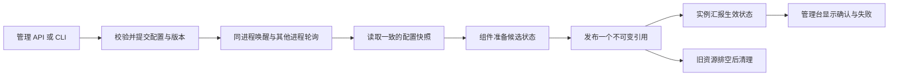

# 统一配置热更新设计

日期：2026-10-27  
状态：实施基线；本次首版范围为 P0–P2，验收待完成  
设计基线：HybridInference `a94aa9d838ca947ae45b2c1b55148f16e19cecf3`

建议建设一套统一的配置应用协议，首批接入告警渠道和失败请求检测参数。统一管理配置版本、刷新、准备与发布、失败重试以及各实例的生效状态；业务组件负责自己的类型校验和资源准备。

保留现有 `app_config`、`site_settings` 和 provider／路由表，保持数据库值优先于环境变量、再优先于默认值的规则。首版不引入 Redis、消息队列或独立配置中心。首次部署新代码仍然需要正常发布；之后修改已接入的配置，不再因此重启后端。

## 1 交付效果与范围

管理员修改生产群 webhook 或检测阈值后，后台返回已保存的版本，并显示各实例正在应用、已生效或失败。组件准备失败时继续使用旧的有效配置，同时保留管理员的新目标值供排查和重试。清空 webhook 是有意暂停投递，不是应用失败。

| 范围 | 首版交付 |
|---|---|
| 通用协议 | 来源版本、原子配置组、统一刷新入口、准备与发布、实例确认、错误状态 |
| 第一个原子组 | `alerts.runtime`：3 个 webhook 配置及 5 个失败请求检测参数 |
| 管理台 | 已保存版本、组件生效状态、实例确认、覆盖范围、脱敏错误 |
| 兼容 | 现有配置 API、数据库优先级、秘密标记、审计、reset/delete、导入与恢复 |
| 后续接入 | `site_settings` 运行时设置；provider、key 和路由；告警引擎生命周期 |
| 单独设计 | YAML 规则编辑、数据库连接切换、签名密钥轮换、熔断和出站并发状态迁移 |

原子性限定在一个进程内的一个配置组。多个实例最终收敛，不承诺同一时刻切换；配置同步不改变现有每进程限流计数，也不提供告警单副本投递或 leader 选举。

## 2 已有基础与需要补齐的部分

现有 `app_config` 支持批量校验、数据库事务和写锁；刷新周期为 10 秒。`runtime_settings` 也有自己的 10 秒刷新。配置页已有生效值、无效原因和 `pending_restart`。这些继续复用。

目前 `app_config._apply()` 先就地修改共享 Settings，再同步调用 `on_change()`。监听器报错只记录日志，不能证明相关组件成功切换。新增机制将“已保存目标”和“正在使用的状态”分开，让接入组件在准备完成后才发布新状态。

已有在线修改继续按原有语义运行，直到接入协议。协议不会给旧监听器自动增加原子性，也不会把“旧式实时读取”标为“组件已确认”。默认每日额度仍只作用于新建 key；覆盖已有角色所有活跃 key 的 `role-apply` 保持独立操作。

## 3 架构与模块职责



建议新增的模块如下，名称可在实现时按现有目录惯例调整。

| 模块 | 职责 |
|---|---|
| `serving/config/revisions.py` | 来源版本、条件写入、一致读取、纪元变化处理 |
| `serving/config/live.py` | 组注册、不可变视图、串行应用器、准备／发布／清理 |
| `serving/config/instances.py` | 进程身份、能力、心跳和组状态汇报 |
| `serving/observability/alert_runtime.py` | `AlertRuntimeConfig` 的投影、校验和访问接口 |

同一来源只由一个入口读取。`app_config.refresh()` 同时为旧式标量适配器和受管组件提供快照；不再为告警增加另一套查询循环。`site_settings` 后续接入时保留独立来源和版本，复用相同应用器。

## 4 配置组与组件接口

一个组拥有一组明确的 key 和一个结构版本。有关联的值放进同一组，例如渠道选择、Slack 回退和检测阈值；互不相关的组独立发布。跨来源的原子组只有在所有写入能使用同一数据库连接、同一事务时才允许声明，否则必须拆组。

组件提供以下接口，框架负责实际发布。

```python
project(source_view) -> Desired | Invalid
async prepare(desired, active) -> Prepared
async discard(prepared) -> None
async retire(previous) -> None

# 框架提供，不调用组件的任意发布回调：
active = group.acquire()  # 获取一个不可变视图
group.publish(prepared)  # 短锁内替换引用，无 await、无外部 I/O
```

`prepare` 可校验、构造客户端或验证必要连接，但不能发测试告警、执行迁移、修改外部系统或抢占当前资源。标量组只构造不可变对象。`Prepared` 必须包含完整可用的视图；有后台任务的组件必须先定义不会提前消费业务的待机状态，无法满足此约束时暂不接入。

读者在相同短锁保护下取得一份引用，之后使用不可变视图。不会依赖“事件循环里没有 await”来推断线程安全。组内各消费方共用同一个视图；多个可变字段的逐个赋值不算原子发布。

受管 key 的读取规则：

- `configured_value()` 表示已保存目标。
- `config_value()` 对受管 key 返回已发布值。
- 告警实际执行路径统一读取 `AlertRuntimeConfig`，不再直接读取那 8 个 Settings 字段。
- Settings 的兼容镜像只能在发布后更新，不作为受管消费者的依据；旧监听器保持原有较弱语义。

注册元数据区分旧式实时读取、受管热更新、需要重启、不可修改。只有适配器、所有执行读者和测试均接入后，相关 key 才能从“需要重启”切换为“受管热更新”。

## 5 持久版本与一致读取

首版新增两张元数据表，不复制配置内容和秘密值。

| 表 | 主要字段 |
|---|---|
| `config_source_revisions` | `source` 主键、`epoch`、`revision`、`updated_at`、`contracts` |
| `config_instances` | `instance_id` 主键、build、capabilities、启动时间、数据库心跳时间、生命周期状态、`groups` |

`contracts` 是非秘密的协议元数据：组名、结构版本、key 归属和是否激活。首版只需要静态的 `alerts.runtime` v1 清单。结构初始化只建立表和未激活的基础记录，不能由新二进制启动或 `ensure_schema` 自动激活组。激活与协议升级必须由操作者通过明确的部署控制命令执行，并在同一事务里推进来源版本；普通配置保存不能自行指定协议能力。读取方根据持久协议要求判断是否支持，避免旧二进制静默忽略新增受管字段。

每个来源使用 `(epoch, revision)`。`generation` 仍是进程内发布次数，与数据库版本分开。表与触发器随 `AppConfigStore` 的幂等配置 schema 初始化，初始化和结构升级受迁移锁保护；不依赖更晚启动的日志 schema。

对 `app_config` 的 INSERT、UPDATE、DELETE、TRUNCATE 使用语句级 BEFORE 触发器，在同一事务内更新来源计数行。计数行不存在时必须先建立，后续触发器也采用明确的插入或更新逻辑，不能静默漏计。允许空操作推进版本，组件通过私下比较类型化投影避免无意义重建。事务回滚同时回滚版本变化；一个事务可以推进多次，外部观察到的版本允许跳号。[PostgreSQL 触发器说明](https://www.postgresql.org/docs/current/sql-createtrigger.html)

触发器记录变化，不承担应用层语义校验。它覆盖旧 API、CLI、启动导入、生成密钥、reset/delete、备份恢复和普通 SQL 写入；禁用触发器、替换表等维护操作需要专门恢复流程。所有副作用仍服从数据库事务。

新写入路径按以下顺序执行：取得现有 advisory 写锁，再锁住来源版本行，检查 `If-Match`，读取当前配置，校验整个候选组，然后批量写入。事务提交后唤醒本进程应用器。死锁等可重试数据库错误使用有界重试；版本冲突返回 409，不自动覆盖用户的新目标。新管理台必须传 `(epoch, revision)`；旧客户端可省略，保持原有后写覆盖先写的兼容语义。

读取使用短的只读 REPEATABLE READ 事务，同时读取来源元数据和配置行；也可采用以版本行为锚的单条查询。配置表为空时仍返回版本。不得先读行、再在另一个快照里读版本。[PostgreSQL 事务隔离说明](https://www.postgresql.org/docs/16/transaction-iso.html)

普通配置备份不导出控制元数据和实例确认，恢复配置生成新版本。看到同一 epoch 下版本倒退时标记 `regressed`，不永久忽略。整库恢复需通过恢复命令换 epoch，并受控重建实例登记；既有元数据不能自行证明恢复后的在线进程集合正确。

## 6 应用流程与失败语义

每个组串行应用，多个组可独立前进。首版采用 10 秒轮询和提交后的本进程立即唤醒，不引入 NOTIFY 专用连接。之后可增加通知提示，但数据库快照仍是事实来源。

1. 投影并验证组配置，记录已检查的来源版本。
2. 投影与生效视图相同时，推进“已核对版本”，无需重建资源。
3. 有相关变化时，异步准备候选；准备有超时和清理责任。
4. 发布前确认候选仍匹配最新已观察到的相关目标。过期候选执行 `discard`。
5. 框架在短锁内发布不可变引用；之后写确认、排空和清理旧资源。

无关 key 的改动不取消准备。相关写入连续到达时合并到最新目标，可采用短去抖；持续无法完成时显示 `pending` 和延迟。不会为了“防止饿死”而强行发布已经知道过期的渠道、禁用或吊销配置。

| 情况 | 结果 |
|---|---|
| 校验或准备失败 | 目标保留，旧生效视图保留，组显示 invalid／failed |
| 新目标替代旧候选 | 清理旧候选，处理最新相关目标 |
| 发布成功、确认写入失败 | 本地已生效但未获持久确认；只重试确认，不重新应用 |
| 旧资源清理失败 | 仍是已生效，另标 `cleanup_degraded`；有界排空与重试 |
| 数据库暂不可用 | 运行中保留最近有效视图，显示读取过期及确认未知 |
| 不支持组结构版本 | 保留旧视图，报告 unsupported，不丢弃未知字段后假装成功 |
| 主动清空渠道 | 正常发布暂停状态，不恢复旧 webhook，不伪造恢复通知 |

准备超时、失败重试按组退避，建议 1 秒起步、60 秒封顶并加抖动；新的相关目标重新尝试。确认上报合并为每组最新状态，保留有界内存，不累积无限历史队列。同一实例的状态写入采用单一写者或单调状态序号，防止较旧上报覆盖较新确认。

取消发生在准备阶段时清理候选；同步发布不允许插入 await。关机先停止新的协调工作，再处理候选、在途使用和已退役资源，遵守整体关机期限。资源版本必须有数量与时间上限；到达上限后暂停新应用并显示清理受阻，不能强关仍在使用的资源或无限保留。

管理员修正错误配置会产生新的版本。首版不保留秘密值的历史副本，因此不承诺任意历史版本一键回滚；已经发出的通知无法撤回。未来密钥吊销组需要额外的拒绝旧凭据和过期截止策略，不能统一采用无限期保留旧值。

## 7 实例确认与管理台

使用每个后端工作进程独立的实例 ID；Pod 名或进程号不能单独作为身份。`groups` 为每组保存 epoch、已检查版本、已核对版本、本地发布代次、结构版本、状态和稳定错误码。它不保存 webhook、密钥、原始校验异常或可被离线猜测的秘密散列。

建议每 10 秒上报，60 秒未见心跳标为“未知／可能离线”，这些是可调整的设计默认值。心跳使用数据库时间。超时不能代替成功确认，也不能证明进程已停止接收请求。历史实例可按保留策略清理，但清理不能把未确认的变更改写为成功。

管理台在现有生效值、invalid 和 pending_restart 的基础上增加：

- 保存目标：例如 `app_config / epoch E / revision 42`。
- 组状态：应用中、生效、暂停、失败、不支持、确认未知、等待重启。
- 覆盖：例如“已登记的 2 个实例中，2 个已核对到版本 42”。
- 部署覆盖是否已由进程／副本清单核对；未核对时明确显示覆盖未知。
- 读取和确认时间、错误码、清理异常；配置应用成功与消息投递成功分开显示。

旧二进制不登记，不能靠新表自动发现它们。先部署具备登记能力、但受管组尚未激活的桥接版本，再部署实际组适配器；由部署流程确认所有服务进程支持所需组版本后，操作者显式执行激活。清单不存在时组休眠；未知组或更高结构版本显示 unsupported，不能静默降级后声称生效。覆盖未知时不得宣称所有实例已完成。

激活前必须预览“当前生效值与已保存目标”的差异，秘密值只显示有无变化。激活会应用此前已经保存、仍在等待重启的值，可能当场改变通知渠道；预览与激活使用条件版本，避免期间被其他写入替换。激活清单不是普通热更新开关。

撤销激活时，已运行进程冻结最后一次受管生效视图，状态为 `dormant-frozen`，直到受控重启；不能悄悄恢复成最初启动时的旧值。新启动进程按当时配置建立基线，因此过渡期需显示状态差异，不能宣称已统一。回退到不理解协议的二进制属于受控部署，不属于普通配置回滚。

新实例先加载并应用基线。告警属于可降级组件，应用失败不能新增一个让整个推理服务不可用的理由；其告警状态必须清楚显示失败。后续路由组件没有有效初始配置时，需要阻止对应请求进入。启动只证明已处理所观察到的基线，不承诺在并发保存期间 ready 瞬间持有全球最新值。

同一数据库版本的确认表示“该进程按自身环境变量与默认值基线解释并应用”。不同镜像、环境变量或部署基线不能仅凭同版本就宣称有效配置完全相同；保留 build、基线标识和配置来源信息，prod 与 staging 分别统计。

## 8 告警首批接入

`alerts.runtime` v1 包含：

| 类别 | 配置 |
|---|---|
| 渠道 | `SLACK_ALERTS_WEBHOOK_URL`、`SLACK_WEBHOOK_URL`、`WECOM_ALERTS_WEBHOOK_URL` |
| 检测参数 | `FAILED_REQUEST_ALERT_THRESHOLD`、`FAILED_REQUEST_ALERT_WINDOW_MINUTES`、`FAILED_REQUEST_ALERT_COOLDOWN_MINUTES`、`FAILED_REQUEST_ALERT_RATE`、`FAILED_REQUEST_ALERT_RATE_MIN_COUNT` |

渠道互斥、Slack 回退及数值范围以完整投影验证。换渠道在同一次批量保存中清空旧配置、填入新配置。三个 webhook 和五个参数发布为一个不可变 `AlertRuntimeConfig`。

保留当前失败请求检测器的激活条件：`SLACK_WEBHOOK_URL` 或 `WECOM_ALERTS_WEBHOOK_URL` 非空。单独设置 `SLACK_ALERTS_WEBHOOK_URL` 不额外启用该检测器；如要统一这一历史语义，另行修改并注明影响。

只要 scheduler 和数据库依赖可用，就注册一个常驻 job 和检测器实例；配置变化不重新注册 job。没有激活渠道时处于暂停状态，不查询、不修改 incident、不发送恢复消息。缺失 scheduler 或数据库依赖时显示检测器不可用，不能仅因配置对象发布成功就声称检测功能已经工作。

每次检测开始取得一个配置视图。每次异步 SQL 返回后，以及真正修改状态和取得发送资格之前，核对该视图是否仍有效；已经过期的评估被丢弃，不改变 tracker 或冷却时间。若投递准备中还有 await，在最终同步状态变更／发送入口再次检查。已开始的 HTTP 投递允许使用原 sink 完成，并记录对应代次；未开始的过期发送计划不再发出。

配置更新保留 `_last_alert_at`、去重状态和模块级 incident 跟踪器。检测阈值改变后，下一次有效评估按新阈值判断；配置保存本身不触发人工恢复。恢复投递和每次恢复补发重新获取当时生效的渠道，不补发历史触发、不长期保留旧 webhook；换群后恢复消息可能出现在新群，应在渠道编辑处说明。`alert_on_transition` 需要接收预期视图或代次，并在状态更新和发送准入点执行一致性检查。

直接告警生产者也在每次投递时取得一份 sink 快照。`ALERTS_ENABLED` 仍只控制现有规则引擎，不成为所有告警的总开关。首版不热切换它，也不重载 `alerts.yaml`、历史采集池或状态类策略。

已有显式测试通知入口保留，并明确测试的是保存目标还是生效配置。`prepare` 不发送任何消息。配置正常传播目标约为 10 秒；失败请求检测仍按原有每分钟周期运行，不能把配置生效时间写成报警到达时间。

## 9 分阶段实施

| 阶段 | 可审阅的交付 | 发布门槛 |
|---|---|---|
| P0 版本基础 | 版本表、触发器、一致读取、epoch、可选 CAS；所有写入路径覆盖 | 只增加追踪，保持现有运行行为 |
| P1 通用应用器 | 不可变组、prepare／discard／retire、实例确认、能力上报、状态 API | 先部署桥接版本，受管组保持未激活 |
| P2 首个完整功能 | `alerts.runtime`、常驻检测器、全部消费者迁移、前端生效状态 | 同一次功能交付同时具备热更新和确认，不先发布不可观察的热更新 |
| P3 其他配置来源 | `site_settings` 接入，复用协议，保持默认额度等原有业务含义 | 清楚标识原子组与独立来源边界 |
| P4 provider 与路由 | 密钥／路由跨实例重建、不可变请求快照、资源排空、吊销策略 | 依赖多实例在线修改之前完成，单独验收在途请求与反馈归属 |
| P5 有状态组件 | 告警引擎生命周期、熔断和出站并发配置 | 保留队列、计数、事故和占用状态，按组件确认迁移规则 |

基础设施 PR 可以分开审阅；对操作者开放的首个版本必须同时包含状态展示与告警适配。第一次上线新代码需要发布，之后才验收配置修改不引起进程重启。

provider 阶段不能只复用现有整表重建函数：请求及 fallback 必须持有一致的路由／adapter／key 视图，资源在租约排空后释放，反馈绑定原 owner。密钥撤销需允许安全屏障拒绝尚未执行的旧凭据，不能为维护请求快照而继续使用已吊销密钥。

现有配置备份恢复跨多个 store／连接池，`before_commit` 并不自动让所有表处于同一事务。首版只保证 `app_config` 内受管组的提交与发布边界；其他来源恢复可能部分成功，必须展示范围和失败。后续跨表组需要同连接事务改造，或明确作为独立操作。

## 10 验收要求

| 验证对象 | 必须证明的行为 |
|---|---|
| 数据库版本 | update、reset/delete、导入、生成密钥、CLI、普通 SQL、TRUNCATE、恢复均可观察；回滚不留下错误版本；允许无意义增量 |
| 快照与并发 | 空表可读版本；值与版本同快照；条件写冲突不丢更改；异常事务可安全重试 |
| 应用器 | 准备失败保留旧状态；过期候选绝不发布；无关改动不反复重建；取消、确认失败、清理超时和新 epoch 均有测试 |
| 两个以上进程 | 健康环境修改首批配置后在 15 秒目标窗口内核对收敛；实例 ID 不变；丢失心跳不被算作成功 |
| 滚动版本 | 未登记旧进程显示覆盖未知；不支持组的进程显示 unsupported；启动不自动激活；激活预览覆盖待重启值；撤销激活不恢复旧启动值 |
| 告警链路 | 假 HTTP 接收器验证正确渠道；不合法互斥组合被拒绝；冷却和 incident 保留；清空暂停；过期评估不产生触发或恢复 |
| 泄漏防护 | 用虚构秘密值检测日志、状态、错误、审计、浏览器响应，确保不出现真实值或秘密指纹 |
| 后续路由阶段 | 长流、fallback、取消、key 撤销、反馈和资源释放维持正确归属；不能用“配置已同步”替代这些测试 |

15 秒是健康环境首批标量配置的验收目标，需实测建立，数据库故障和组件准备超时会显示未收敛。默认测试使用本地假接收器；部署验收使用明确标注、在授权范围内的测试消息。

代码测试、合并、staging 验收和生产验收分别记录。staging 验收增加持续请求探测，确认配置变更没有引入后端重启或由该操作造成的 5xx；生产沿用已验收版本另行核对。

## 11 依据与讨论记录

代码基线为公开上游 `a94aa9d838ca947ae45b2c1b55148f16e19cecf3`；下列链接固定到该版本。

- [配置存储、批量写与写锁](https://github.com/HarvardMadSys/hybridInference/blob/a94aa9d838ca947ae45b2c1b55148f16e19cecf3/apps/backend/serving/config/app_config_store.py#L122)
- [共享 Settings 应用与通知](https://github.com/HarvardMadSys/hybridInference/blob/a94aa9d838ca947ae45b2c1b55148f16e19cecf3/apps/backend/serving/config/app_config.py#L859)
- [配置备份恢复入口](https://github.com/HarvardMadSys/hybridInference/blob/a94aa9d838ca947ae45b2c1b55148f16e19cecf3/apps/backend/serving/servers/routers/admin/config_backup.py#L1105)
- [失败请求检测器与实例冷却状态](https://github.com/HarvardMadSys/hybridInference/blob/a94aa9d838ca947ae45b2c1b55148f16e19cecf3/apps/backend/serving/admin/failed_request_alerter.py#L196)
- [渠道选择和模块级 incident 跟踪器](https://github.com/HarvardMadSys/hybridInference/blob/a94aa9d838ca947ae45b2c1b55148f16e19cecf3/apps/backend/serving/observability/alerts.py#L664)

