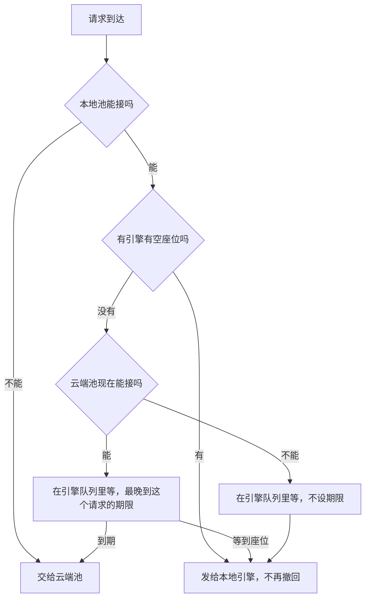

# Greedy Router 设计：本地优先的 Spillover 与 Cutoff

- 日期：2026-11-23
- 状态：草案，待评审。尚未实施，本文不改变任何运行行为。
- 前序设计：[可组合的 Hybrid Routing 设计](2026-09-14-composable-hybrid-routing-design.zh.md)。那份设计把 GreedyRouter 留作未来扩展，本文补上其中不做预测的那一种，见 3.3。
- 将接替：`FixedRouter` 里的 [queue-wait offload](../../developer/routing.md#queue-wait-offload) 这一个功能。`FixedRouter` 本身保留；offload 在迁移完成后删除，见第 10 节。
- 对齐对象：Nimbus 项目里的 Cutoff 和 Spillover 两个基线，逐项对照见 5.6。
- 代码参照：`dev` @ `94a693e4`

## 1. 结论

给同时有自建引擎和云端 API 路由的模型，新增一个按模型选用的路由策略：`router: greedy`。它只决定一件事：一个请求留在本地，还是上云。规则是本地优先。

- **有空座位就发本地。** 座位是引擎上"已发出、还没出首 token"的名额，每个引擎 N 个。
- **没有空座位时**，看模式：
  - **Spillover**：不等，直接上云。
  - **Cutoff**：在网关里等，最晚等到这个请求自己的期限，到期就交给云端。期限按请求计算：再晚上云，云端也来不及在它的首 token 预算内出首 token。
- **发给引擎的请求不再撤回。** 去本地还是去云端，在请求发出之前决定。

这两种模式按 Nimbus 项目里 Cutoff 和 Spillover 两个基线的定义来做：放行条件、期限的算法、不撤回都相同。网关看不到引擎内部状态造成的差别，列在 5.6。

`FixedRouter` 本身保留，没有选用这个策略的模型仍然由它负责。这个策略接替的只是 `FixedRouter` 里的 offload 这一个功能，而且 offload 的删除放在最后一步，见第 10 节。排队沿用网关已有的机制，并对它做四处改动：发往引擎的请求全部计数；N 和期限改为显式传递；加监控；校验"单进程"这个前提。

`greedy` 和 `FixedRouter`、`RouteWiseRouter` 平级，不改这两者的选路行为。池内选哪条路由、怎么执行、怎么记账，仍由共享的 `FixedRouter` 负责。

本文不是 Nimbus 的接入方案，网关的队列也不为它预留位置，见 3.4。

## 2. 背景

### 2.1 今天的 offload

管理员可以给一个 `fixed` 模型指定一条 offload 路由和一个等待秒数 x。之后有三种情况会把请求送到这条路由：

- **Queue wait。** 请求在网关的出站队列里等了 x 秒还没拿到位置。
- **Engine wait。** 请求已经发给引擎，x 秒内没出首 token。网关取消它，再发给 offload 路由。
- **Last resort。** 其他路由都不可用或都失败了。

另有一个可选的 engine queue limit N：每个自建引擎上，还没出首 token 的流式请求最多 N 个，其余的在网关排队。这个排队机制在限流器里（[upstream_limiter.py](../../../apps/backend/serving/adapters/upstream_limiter.py) 的 `EngineHold` 和 `_EngineGate`），本文称它为引擎队列，并在它上面做改动。

### 2.2 offload 的问题

1. **先发后撤。** Engine wait 触发时，请求已经在引擎里排队，甚至已经在 prefill。撤回只能靠断开连接。网关和引擎之间隔着代理时，引擎可能收不到断开，要算到第一次往回写才停。结果是本地白算一次，云端又付一次钱，本地队列也没有减轻。
2. **只有"等一会儿再上云"这一种。** 没有"引擎忙就直接上云"的选择。对多轮、长上下文的负载，请求等待期间，同一会话留在引擎里的前缀缓存可能被挤掉，下一轮就变成冷的 prefill。这一点需要用回放验证，见第 11 节。
3. **逻辑住在 `FixedRouter` 里。** 普通选路要先排除 offload 路由，fallback 顺序要按 offload 的原因重排，被截断的请求最后还要回原路由重试。这些规则和权重选路、健康、亲和、流式提交交织在一起。`routewise` 模型和开启 `hybrid_composition` 的模型用不了它。
4. **一个模型只能有一条 offload 路由，而且它不再接普通流量。** 权重表里出现了一条权重不生效的路由。

### 2.3 现有排队机制的不足

它的并发细节是可靠的：计数的修改在没有 `await` 的代码块里完成，叫醒等待者时由叫醒的一方先记上座位，超时和取消与叫醒撞在同一刻的情况有处理，座位只归还一次。不足在别处：

1. **只数了一部分请求。** 只有 `FixedRouter` 为带 offload 策略的模型发出的流式请求才进队列，带 pin 的也算在内。非流式请求和 `/v1/messages` 直接发给引擎，队列看不见。所以它的计数不是引擎的真实状态。
2. **靠隐式上下文传递。** N 和期限由 router 放进请求上下文，限流器在深处读出来；首 token 的上报也经由上下文找到队列。不经过 router 的入口没有这份上下文。新写的 adapter 漏了上报，座位就要等到请求结束才归还，而且不会报错。
3. **N 跟着请求走。** 每个请求带一个 N，引擎取最后到的那个。两个模型共用一个引擎时，谁后到听谁的。
4. **看不见。** 没有指标，admin 的限流页面也不显示它。排了多少、等了多久，查不到。
5. **只在一个进程的内存里，而且没有校验。** 多个 worker 或多个网关各数各的。生产是单 worker（见 [architecture.md](../../developer/architecture.md)），所以今天没有出问题，但代码不检查这个前提。

### 2.4 术语

| 术语 | 含义 |
|---|---|
| 本地池 | 模型的自建路由，按路由的 `deployment_type` 判定，与限流器、`hybrid_composition` 用同一个判定 |
| 云端池 | 模型的其余路由 |
| 引擎队列 | 网关为一个自建引擎扣住请求的地方，每个引擎一个，在限流器里 |
| 座位 | 引擎上一个"已发出、还没出首 token"的名额，一共 N 个 |
| Spillover | 没座位就直接上云，不等 |
| Cutoff | 没座位先在网关等，等到这个请求的期限再上云 |
| 期限 | 一个请求最晚什么时候必须改走云端。Cutoff 下每个请求各算各的，见 5.3 |

## 3. 设计决定

1. **新增路由策略 `greedy`**，是 `RouterProtocol` 的一个平级实现，按模型选用。未选用的模型行为不变。
2. **一条规则，两种模式。** Spillover 和 Cutoff 只差请求的期限：Spillover 的期限就是到达时刻，Cutoff 的期限按请求计算（5.3）。不写成两个 router。
3. **发出去的请求不撤回。** `greedy` 没有 engine wait。
4. **与 Nimbus 的基线对齐。** 放行条件、Cutoff 的期限、不撤回，都按 Nimbus 项目里 Cutoff 和 Spillover 两个基线的定义。对不上的地方只来自网关看不到引擎内部的状态，逐项列在 5.6。
5. **沿用现有的引擎队列，只做四处改动。** 放行规则不变：按到达顺序放行，直到已发出还没出首 token 的请求数达到 N。不引入可替换的准入策略。
6. **所有请求都计数。** 队列按引擎登记。只要引擎登记了队列，发往它的每个请求都进队列，包括今天不计数的非流式请求和 `/v1/messages`。
7. **池内的事交给后端。** 入口只决定去哪个池、带什么期限。本地池和默认的云端池都包在共享 `FixedRouter` 外面，权重选路、健康、prefill 感知、亲和、执行和记账都不重写。云端池是一个可以替换的后端，见 7.6。
8. **显式契约。** N 是引擎的配置，登记在队列上。请求只带一个期限，用类型化的字段传递，见 7.3。
9. **单进程是前提，并且要校验。** 检测到多个 worker 时，拒绝启用引擎队列。
10. **先并存，后删除。** `fixed` 模型上的 offload 在迁移完成之前保持原样。

### 3.1 范围

- 对引擎队列的四处改动：按引擎登记并覆盖所有请求、显式传递、指标、worker 校验。
- `greedy` 路由策略，以及它在 `/v1/chat/completions`（含建在它上面的 `/v1/responses`、`/v1/completions`、admin playground）和 `/v1/messages` 两个入口的接入。

### 3.2 不做

- 不预测本地的情况。不估算本地的首 token 时间、KV 占用或输出长度，不需要校准引擎。Cutoff 用到的云端首 token 时间是配置进来的一条直线，不是在线估计。
- 不做可替换的准入策略，不改放行顺序。
- 不做跨进程共享的队列，不把队列搬到引擎旁边的独立进程里。
- 不做优先级和公平性，队列长度不设上限，见未决问题 5。
- 不改引擎，不改 `FixedRouter` 和 `RouteWiseRouter` 的选路行为。
- 不接入 Nimbus，也不为它预留接口，见 3.4。

### 3.3 与前序设计的差异

- **准入方式。** 9/14 设计第 5 节和 7.3 节设想的 Greedy，用 KV 预留和预测 TTFT 做本地准入，需要 `local_admission_profiles` 一类的校准参数。本文只看"还有几个请求没出首 token"，不做预测。
- **名字。** 沿用 9/14 设计的叫法 GreedyRouter。这里的 greedy 指本地优先的简单规则，对应 Nimbus 项目里 Cutoff 和 Spillover 两个基线，见 5.6。Nimbus 项目里另有一个名叫 greedy 的策略，是做 SLO 预测的那一种，两者不是一回事，见未决问题 12。
- 9/14 设计的其余部分继续有效：Router 契约、Leaf 与池、精确派发与池委托、资源和反馈的归属。

### 3.4 与 Nimbus 的关系

Nimbus 这类调度器按引擎的 decode step 做决定，它需要的东西网关的限流器这一层给不了：

- 它在请求出首 token 之后仍然跟踪它，直到生成结束，并且从每个 token 的到达时间里数出 decode step。引擎队列在首 token 时就归还座位，之后不再看这个请求。
- 它为每个请求维护自己的定时器，并会随引擎缓存的变化改期。到期时，如果能证明安全，请求继续留在队列里，之后整批放行。引擎队列的期限由调用方给定，到期就离开。
- 它需要精确的 prompt token 数和引擎的缓存事件。限流器看不到请求内容。
- 它对派发延迟敏感，要和引擎跑在同一台机器上。网关进程同时在做鉴权、记账、协议转换和多个模型的流式转发。

所以两者这样分工：

- Nimbus 由引擎旁边的独立进程承载，自己扣住请求。网关把模型的本地路由指向那个进程。它的接入是另一份设计。
- **两者不叠加。** 一个引擎前面要么是网关的引擎队列，要么是那个进程。路由指向那个进程时，不要给模型选 `greedy`，也不要为这个引擎登记队列，否则请求会先在网关里排一次队，那个进程看到的到达时间和排队情况都是错的。

## 4. 引擎队列

### 4.1 它是什么

每个自建引擎一个队列，在限流器里。它记录已发出还没出首 token 的请求数，让超出 N 的请求按到达顺序等。放行规则只有一条，本文不改：

- 有座位归还或有等待者离开时，按到达顺序放行等待者，直到已发出还没出首 token 的请求数达到 N。

### 4.2 按引擎登记

- 一个引擎是否有队列、N 是多少，是引擎的配置，登记在队列上。请求不再各带一个 N。
- 一个 `greedy` 模型的 router 启动时，把它本地池里的引擎连同 N 登记上去；路由表变化时同步更新；router 停止时注销。登记以模型为单位（`set_engine_queues(模型, {引擎地址: N})`，注销是 `clear_engine_queues(模型)`），同一个模型再登记一次就整组替换，所以重建出来的 router 直接接手原来的队列。登记返回一个 token，注销时带上它（`clear_engine_queues(模型, token=...)`），只有这一组还是这次登记的才清除：被替换的旧 router 停止时，不会清掉新 router 已经接手的队列。路由表刷新后重新登记失败（例如新加的引擎与别的模型 N 冲突）时，原来那次登记保持不变，请求只发往上次登记成功的那些引擎，新加进来的引擎在登记成功之前不接请求。
- 两个模型共用一个引擎时，N 必须一致，否则后启用的那个被拒绝，并说明冲突的是哪个引擎。被拒绝时什么都不改。
- 一个引擎没有任何模型登记了：新来的、不带 engine hold 的请求不再计数，直接发给引擎；还在排队的这类请求立刻放行，不让它们排在新请求后面；已经计数的请求照常归还座位。旧 offload 路径带 engine hold 的请求不受影响，照旧按自己的 N 排队。队列里什么请求都没有了，这个队列就被丢掉，不再出现在 admin 视图里。
- 队列按路由的地址识别引擎。一个地址后面是负载均衡的多个引擎实例时，N 是这组实例合计的名额，控制会变粗，见未决问题 6。

### 4.3 谁进队列

只要引擎登记了队列，发往它的每一次派发都进队列。这在限流器这一层做，所有入口发往引擎前都要经过它，不需要各个入口分别配合。

每个请求可以带一个期限：

- **带期限**的请求到期还没被放行，就以"到期"离开队列。此时什么都没发出。它的调用方知道怎么把它送去云端。
- 请求到达时期限已经过了，又没有空座位：不进入等待，直接以"到期"离开。Spillover 靠的就是这一条。
- **不带期限**的请求一直等到轮到自己。等待超过限流器的获取超时后，它照常发给引擎，即使超过了 N。队列决定请求在哪里等，不让请求失败。

不知道该把请求送去哪里的入口，不带期限就行，行为是安全的：请求被计数，按顺序等。

### 4.4 座位什么时候归还

- 引擎返回这个请求的第一段输出时归还。
- 这次尝试结束时一定归还，如果此前还没归还的话。

**非流式请求**没有首 token。网关已经有一条现成的路径处理这种情况：运行时设置 `force_chat_completions_streaming` 打开后，非流式的 chat 请求以流式发往上游，网关缓冲后仍返回普通的非流式响应。对登记了队列的引擎，非流式的 chat 请求一律走这条路径，不取决于那个全局设置。这样它也有首 token 信号，不会把座位一直占到生成结束。

这条路径今天只接在 `/v1/chat/completions` 这个入口上，不用于 Responses API 和 batch 请求，`/v1/messages` 的非流式请求也没有对应的路径。这三类在第一版里要么补上同样的路径，要么仍向引擎发非流式请求、座位占到响应返回为止。后一种做法下，这样一个请求会在整个生成期间占着座位。见未决问题 4 和 5。

### 4.5 进程范围

队列的状态在一个网关进程的内存里。

- 启用引擎队列时检查 worker 数。配置了多个 worker、进程是由 worker 管理器派生的，或者在 gunicorn 下运行，就启动失败并说明原因。判断方式在 [workers.py](../../../apps/backend/serving/utils/workers.py) 的 `several_workers()`，与 handoff 的检查共用。`uvicorn --reload` 也会被拒绝，因为它和 `--workers` 从进程内分不出来。
- 多个网关副本无法在进程内检测。这是部署要求：一个引擎只能由一个网关进程派发。
- 重启后队列从空开始。在途请求随旧进程结束。

## 5. `greedy` 的行为

### 5.1 一个请求的流程



### 5.2 规则

1. **划池。** 每次请求时，按当前路由表把模型的路由分成本地池和云端池。两侧都只用池自己执行时认的范围（随路由表刷新），所以计划不会点名池会拒绝的端点；配置的上下文窗口放不下这个请求（按估算的 prompt 长度）的路由，两侧都不用。
2. **座位。** 本地池里选中的引擎有空座位，就发出去。已经在生成的请求不占座位，所以队列不限制引擎同时跑多少个请求，只限制同时有多少个在排队或 prefill。
3. **期限。** 每个请求有自己的期限，从它到达 router 时起算，算法见 5.3。Spillover 的期限就是到达时刻，所以不进入等待，直接算到期。
4. **只有云端接得住才设期限。** 云端池里此刻没有这个请求可用的路由时，请求不设期限，一直等本地座位。"接不住"包括：调用方没有可用的 key、熔断都开着、模态不支持、上下文窗口放不下、超过 `cloud_max_input_tokens`、调用方把范围限定在本地路由。
5. **到期上云。** 请求到期时什么都没发出去，所以没有要取消的东西，也不记入本地引擎的健康统计。它交给云端池，池内怎么选路由云端后端自己决定。
6. **本地失败。** 请求已发给引擎，在客户端看到任何输出之前失败了，就交给云端池一次。这是普通的 fallback，不是溢出。
7. **云端失败。** 云端池整体失败时，如果这个请求之前是因为没座位才离开本地的，就回本地一次，这次不设期限。`greedy` 可能让一个请求变慢，但不会让一个本地本来接得住的请求失败。
8. **提交。** 客户端一旦看到输出，这次尝试就定了，之后的错误直接返回，不再换路。

一个请求最多经过三步：本地（带期限）、云端、本地（不设期限）。不会循环。

### 5.3 两种模式和今天的 offload

| | Spillover | Cutoff | 今天的 offload |
|---|---|---|---|
| 没有空座位时 | 立刻上云 | 在网关等，最晚等到这个请求的期限 | 配了 engine queue limit：在网关等 x 秒。没配：直接发给引擎 |
| 期限 | 到达时刻 | 按请求计算，见下 | 所有请求同一个 x 秒 |
| 已经发给引擎的请求 | 不撤回 | 不撤回 | x 秒没出首 token 就取消并上云 |
| 哪些请求被计数 | 发往这个引擎的全部请求 | 同左 | 只有 `FixedRouter` 发出的流式请求 |
| 上云去哪里 | 模型的全部云端路由 | 同左 | 指定的一条 offload 路由 |
| 云端路由平时接流量吗 | 不接，只接溢出 | 同左 | offload 路由不接，其他云端路由按权重接 |

**Cutoff 的期限。** 一个请求的期限，是它最晚必须改走云端的时刻：再晚，云端也来不及在它的首 token 预算内出首 token。算法与 Nimbus 的 Cutoff 基线相同：

```text
首 token 预算(n)     = ttft_budget.fixed_ms + ttft_budget.per_token_ms × max(0, n - ttft_budget.threshold_tokens)
云端首 token 时间(n) = cloud_ttft.fixed_ms + cloud_ttft.per_input_token_ms × n
期限                 = 到达时刻 + 首 token 预算(n) - 云端首 token 时间(n) - margin_ms
```

- n 是这个请求的 prompt token 数，按整个 prompt 算，不管缓存命中多少。
- 首 token 预算是运营方定的要求：prompt 越长，允许的首 token 时间越长。
- 云端首 token 时间是量出来的一条直线，按 prompt 完全不命中缓存算，因为网关看不到云端的缓存。
- `margin_ms` 是留给网关派发和网络的余量。
- 云端首 token 时间超过预算的请求不设期限：云端也赶不上，它就一直等本地座位。
- 算出的期限不晚于到达时刻的请求，和 Spillover 一样处理：有空座位就发本地，否则立刻上云。

结果是 prompt 长的请求可以等得更久，短的请求等不了多久就上云。参数见第 8 节。

**固定等待。** `max_wait_seconds: x` 让所有请求用同一个 x 秒，和今天 offload 的 queue wait 相同。保留它是为了把现有的 offload 配置原样迁过来（第 10 节）。它不是 Nimbus 的 Cutoff，需要对齐时用上面按请求计算的期限。

### 5.4 各类请求怎么过队列

| 请求 | 进队列 | 能溢出到云端 | 说明 |
|---|---|---|---|
| 流式的 chat 请求 | 是 | 能 | 按 5.2 的规则 |
| 非流式的 chat 请求 | 是 | 能 | 网关对引擎用流式请求，见 4.4 |
| `/v1/messages` | 是 | 能 | 这个入口自己挑 adapter，不调用 router，接入方式见 7.5。非流式请求的座位归还见 4.4 |
| 带 pin 的请求 | 是 | 不能 | 它指定了一个端点，不带期限，按顺序等 |
| 调用方限定了路由范围，例如 batch 只许走本地路由 | 是 | 范围里有云端路由才能 | 范围里没有云端路由时不设期限。batch 不会被挤到付费的云端 |
| embeddings | 否 | 不涉及 | 不经过 router 选路，也不发往生成引擎 |

batch 和交互请求排在同一条队里。batch 请求占着座位时，Spillover 下的交互请求会溢出到云端。是否让交互请求优先，见未决问题 5。

### 5.5 多个本地引擎

本地池内选哪个引擎由 `FixedRouter` 决定，沿用权重、亲和和 prefill 感知。选中的引擎没有空座位、期限又已经到了，池内的 fallback 会接着试下一个本地引擎，所以 Spillover 下只要任何一个本地引擎有空座位，请求就留在本地。Cutoff 下请求在第一个选中的引擎那里排队，不会中途换到先空出来的另一个引擎。第一版接受这一点。

### 5.6 与 Nimbus 基线的对照

`greedy` 的两种模式按 Nimbus 项目里 Cutoff 和 Spillover 两个基线的定义来做。那两个基线跑在引擎旁边，看得到引擎内部的状态；网关看不到，所以有几项对不上。

| 规则 | Nimbus 的基线 | `greedy` | 是否一致 |
|---|---|---|---|
| Cutoff 什么时候放行 | 已放行的请求都出了首 token，才放下一批 | 已发出还没出首 token 的请求少于 N | N 取 1 时一致 |
| Spillover 什么时候留在本地 | 到达时引擎马上能开始处理它，否则立刻上云，之后不改 | 到达时有空座位，否则立刻上云，之后不改 | N 取 1 时一致 |
| Cutoff 的期限 | 到达时刻 + 首 token 预算 - 云端首 token 时间 - 余量，每个请求各算各的 | 同一个公式，同样的参数（5.3） | 一致。token 数是估算的，见未决问题 10 |
| 云端也赶不上预算的请求 | 不设期限，一直等本地 | 同左 | 一致 |
| 已发给引擎的请求 | 不撤回 | 不撤回 | 一致 |
| 本地放不进上下文的请求 | 到达时直接上云 | 本地池接不了，直接上云 | 一致 |
| 一次放行多少 | 引擎下一轮 prefill 能处理多少就放多少：按还没缓存的 prompt token 数和引擎的 chunk 大小算，几个短 prompt 可以一起放 | 按个数，N 个 | 不一致，见未决问题 7 |
| 显存和并发上限 | 放行前检查 KV 预留放不放得下、是否超过引擎同时运行的请求数上限 | 不检查 | 不一致。网关看不到引擎的 KV 占用 |
| 云端的出字速度 | 达不到 TPOT 要求时，所有请求都不设期限 | 不检查，`greedy` 没有 TPOT 的配置 | 不一致。选用 Cutoff 即表示云端的速度可以接受 |
| 故障时的兜底 | 没有 | 本地失败上云一次，云端失败回本地一次（5.2 的规则 6、7） | `greedy` 多出来的，只在出故障时起作用 |

要和 Nimbus 的实验放在一起看时，用 N 取 1 加 Cutoff 的按请求期限，并把表里不一致的几行计入解读。

## 6. 构成

```text
ModelRouterRegistry
  └─ GreedyRouter                    入口：期限，最多三步的计划
       ├─ 本地池   scope = 模型的自建路由 ──> 共享 FixedRouter ─┐
       └─ 云端池   scope = 模型的其余路由 ──> 云端后端           ├─> LeafBackend → Adapter → 引擎队列 → 引擎
                                              （默认也是共享 FixedRouter）  └─> LeafBackend → Adapter → 云端 API

/v1/messages ──（自己挑 adapter）────────────────────────────────> Adapter → 引擎队列 → 引擎
```

两个入口发往自建引擎的请求，最后都经过同一个引擎队列。

## 7. 复用与新增

### 7.1 复用的部分

| 能力 | 现有实现 | 用法 |
|---|---|---|
| 扣住请求、计数、到期 | [upstream_limiter.py](../../../apps/backend/serving/adapters/upstream_limiter.py) 的 `EngineHold`、`_EngineGate`、`UpstreamQueueWaitExpired` | 沿用，做 7.2 的四处改动 |
| 首 token 上报 | [dispatch_watch.py](../../../apps/backend/serving/adapters/dispatch_watch.py) 的 `report_first_token` | 沿用上报的时机，归还座位的路径见 7.2 |
| 非流式请求转流式 | 运行时设置 `force_chat_completions_streaming` 背后的那条路径 | 对登记了队列的引擎一律启用 |
| 本地与云端的归属 | `is_local_endpoint` 和路由的 `deployment_type`；[hybrid_composition.py](../../../apps/backend/serving/servers/hybrid_composition.py) 里按实时路由表读取两侧范围的逻辑 | 原样使用 |
| 带范围的池 | [backends.py](../../../apps/backend/routing/backends.py) 里包在共享 `FixedRouter` 外面的池；`hybrid_composition.py` 里替换云端后端的口子 | 原样使用，不新增包装类 |
| 池内选路、健康、prefill、亲和、模态、key 分级、窗口跳过、执行、`_routing` | [routers.py](../../../apps/backend/routing/routers.py) 的 `FixedRouter` | 原样使用 |
| 跨池的尝试顺序、流式提交、历史合并、反馈归属 | [hybrid.py](../../../apps/backend/routing/hybrid.py)、[hybrid_attempt_history.py](../../../apps/backend/routing/hybrid_attempt_history.py)、[hybrid_stream_frames.py](../../../apps/backend/routing/hybrid_stream_frames.py) | 抽成两个入口共用的函数，并补上一种结果，见 7.4 |
| 注册、按模型选择、运行中切换 | [strategies/](../../../apps/backend/routing/strategies/__init__.py)、[model_router_registry.py](../../../apps/backend/routing/model_router_registry.py)、admin 的策略切换接口 | 新增一个名字 |

### 7.2 对引擎队列的四处改动

| 改动 | 内容 | 对应 2.3 的哪一条 |
|---|---|---|
| 全部计数 | 队列按引擎登记，发往它的派发全部进队列；非流式请求走强制流式路径 | 1 |
| 显式传递 | N 登记在引擎上；期限用类型化字段传递；设置上下文的代码集中到一个辅助函数；座位在首 token 时由 adapter 手里的 slot 归还，不再经由请求上下文去找队列 | 2、3 |
| 监控 | 指标、admin 视图、漏报检测 | 4 |
| 校验 | 启动时检查 worker 数 | 5 |

"由 slot 归还"是全部计数的前提：`/v1/messages` 不经过 router，没有 router 放进去的那份上下文。adapter 拿到的 slot 本来就带着这个座位，并负责在尝试结束时归还，让它在首 token 时也归还，各个入口就都一样了。具体做法：adapter 上报首 token 时把手里的 slot 一起交出去（`report_first_token(slot)`，由 `UpstreamSlot.first_token()` 归还座位）。

迁移期间，`fixed` 模型上的 offload 仍然按请求挂队列，行为不变。这条旧路径在删除 offload 时一并删除。

### 7.3 新增的契约：期限

在 `RoutingRequestOptions` 上加一个字段：

```python
# time.monotonic() 时刻。这次派发在自建引擎的队列里最多等到什么时候。
# None 表示一直等到轮到自己。
engine_queue_deadline: float | None = None
```

`FixedRouter` 派发一次发往自建引擎的尝试时，把这个期限交给引擎队列，并且不挂首 token 计时。`GreedyRouter` 只在委托本地池时带上它。

带了这个期限的请求，由调用方决定它到期后去哪里，所以 `FixedRouter` 对它不跑自己的 offload：没有 offload 的期限，没有首 token 计时，不带 engine hold；offload 策略指定的那条路由，在选路和 fallback 里都当普通路由对待。一次尝试在引擎队列里等到这个期限，什么都没发出，所以它不是失败：不记进失败尝试，不清掉调用方的亲和，不再重试同一个引擎，池内照常试下一个引擎。所有尝试都这样到期时，抛出 `UpstreamQueueWaitExpired`；有别的引擎真的失败时，报的是那个失败，并在错误上注明哪些引擎是到期跳过的（`engines_left_unsent`），调用方据此知道云端失败后还能回本地等它们。发往云端的尝试不带这个期限。期限不是有限的数字时，构造 `RoutingRequestOptions` 就会报错，不会在某次尝试里出错、被记到引擎的健康统计上。

需要这个字段的原因有两个：

- `FixedRouter` 在每次尝试外面都会重新设置期限这个上下文键（[routers.py](../../../apps/backend/routing/routers.py) 里四处 `req_ctx.push`）。外层 router 事先设好的值传不进去。
- [routing/AGENTS.md](../../../apps/backend/routing/AGENTS.md) 要求关键的生命周期状态不能只靠隐式上下文传递。

`FixedRouter` 和 `/v1/messages` 到限流器之间，仍然通过请求上下文把期限带到 adapter 里，但设置它的代码集中在一个辅助函数里（限流器模块里的 `dispatch_queue_context`），两个入口共用，不再各写一份。

删除 offload 之后，`FixedRouter` 里与此相关的代码只剩"选项里有期限就交给队列"这一小段。

### 7.4 入口这一层

`GreedyRouter` 自己的逻辑只有 5.2 的规则：算出期限，按"本地、云端、本地"的顺序委托。有三件事和 `HybridRouter` 已经做的一样：

- 一步失败、且客户端还没看到输出时，才走下一步。
- 把各步的尝试记录合并进 `_routing`。
- 把反馈交还给实际执行了那次尝试的池。

实施时把 `hybrid.py` 里这部分抽成两个入口共用的函数（[pool_attempts.py](../../../apps/backend/routing/pool_attempts.py)），`GreedyRouter` 不复制一份。抽出来的函数不能原样使用，有三处要处理：

1. **补一种结果：离开队列，什么都没发。** 今天的执行循环只区分两种结果。"被拒绝"是没发出、不记录，例如熔断全开。其余的异常都算"失败"：记成一次失败的尝试，并参与"最后报哪个错"的选择。排队到期两者都不是。按今天的代码，它会被当成普通失败，出现在失败尝试的记录里；云端随后也失败时，报给调用方的还可能是"排队到期"而不是云端的真实错误。它需要单独的一类：不记成失败的尝试，不参与报错的选择，只记为上云的原因（第 9 节），并且允许之后回到本地。
2. **计划能回到本地。** `HybridRouter` 的计划不会回到已经试过的那个后端。`GreedyRouter` 用自己固定的三步计划，第三步的本地委托不点名具体端点，由本地池自己选。
3. **流式请求的第一帧。** `FixedRouter` 在请求进入引擎队列之前，就先产生一帧 routing 元数据，这一帧会先被转发出去。它对客户端不可见，不算"已提交"，所以到期后仍然可以改走云端。服务层把带 `fallback` 的一帧当作新一次尝试的开始，用它替换之前合并的字段，其余的帧逐键合并在上面。所以本地之后的每一步，`GreedyRouter` 先发一帧带 `fallback` 的 routing 帧，写上之前各步的失败记录和上云的原因。池在内部换路由时也会发一帧带 `fallback` 的帧，把这些字段冲掉，所以池发出的每一帧，`GreedyRouter` 都把它们补上（共用函数的 `stamp` 参数）；最后报给调用方的错误也一样补上（`mark` 参数）。测试确认：溢出之后，请求日志记录的是云端路由和溢出原因，没有残留本地那一帧的字段。

不把 `greedy` 做成 `HybridRouter` 的一个 policy，原因是那个 policy 只返回"去哪个后端"这一项数据，模块说明里写明它不做准入和排队。`greedy` 要给每一步带不同的期限，还要有"回本地"这一步，这两点那个接口都表达不了。

### 7.5 `/v1/messages` 的接入

这个入口自己挑一个 adapter 直接派发，没有 fallback。接入分两层：

- **计数是自动的。** 队列按引擎登记，它发往引擎的请求和别的请求一样进队列。
- **溢出需要它配合。** 对 `greedy` 模型，它按"本地路由在前"的顺序挑选；派发到本地路由时带上和 5.2 相同的期限；到期时改选云端路由一次。

"到期后改选一次"是安全的：到期时什么都没发出，没有重复生成，也没有已经发给客户端的输出。除此之外它仍然没有其他 fallback，云端失败时照常返回错误。期限怎么算、云端接不接得住，用 `GreedyRouter` 提供的同一个函数，不在这个入口里再写一遍。

### 7.6 云端池

入口持有的云端池是一个后端，入口只对它说"这个请求交给你"，不关心它内部怎么选。

- **默认**是包在共享 `FixedRouter` 外面、范围限定为云端路由的池，池内按权重选路，带自己的 fallback。
- **可以替换。** 组合根已经有替换云端后端的口子，9/14 设计也已经有范围限定为云端的 RouteWise 后端。云端有多个 provider、需要按成本和延迟选择时，可以换成它。
- **替换的前提。** 9/14 设计 6.1 节指出，多个 RouteWise 实例访问同一个受限资源池（quota 或 concurrency）时，计数不共享。这项工作完成之前，只有云端路由不与其他 RouteWise 实例共用受限池的模型，才能把云端池换成 RouteWise。
- **"云端接不接得住"由入口判断。** 5.2 的规则 4 要在请求进队列之前知道云端此刻能不能接它。这个判断用共享 `FixedRouter` 现有的候选查询（`eligible_adapters`，`/v1/messages` 今天就用它挑 adapter），范围限定为云端路由；它没有覆盖的条件在入口补上。这样不要求云端后端提供新的接口，云端池换成别的后端时照样可用。

第一版是否在模型参数里开放这个选择，见未决问题 3。

### 7.7 构建

`greedy` 需要拿到共享的 `FixedRouter` 来建两个池。它和 RouteWise 一样走 Registry 现有的后绑定：策略注册表按参数建出 router，Registry 再调用 `attach_route_table(共享 router, model_scope={模型 id})`，不需要组合根的工厂。模型缺少自建路由或云端路由时，这一步就报错，启动失败并说明原因。两侧范围按实时路由表读取，路由被改动后不用重建 router；引擎的登记随路由表刷新（`refresh_route_table()`）同步。

它是一个 managed router：启动时登记引擎队列，停止时注销，注销只清除自己那次登记（见 4.2）。没有被启动过的 router 在第一个请求时补登记，并记一条警告：不登记，期限就没有意义。

## 8. 配置

沿用模型目录里的 `router` 和 `router_params`：

```json
{
  "id": "example-model",
  "router": "greedy",
  "router_params": {
    "engine_queue_limit": 1,
    "cutoff": {
      "ttft_budget": { "fixed_ms": 4000, "per_token_ms": 0.5, "threshold_tokens": 2000 },
      "cloud_ttft": { "fixed_ms": 1000, "per_input_token_ms": 0.1 },
      "margin_ms": 50
    },
    "cloud_max_input_tokens": null
  }
}
```

上面是 Cutoff 的写法，数值只是示例。去掉 `cutoff` 就是 Spillover。

| 参数 | 含义 | 取值 |
|---|---|---|
| `engine_queue_limit` | N，这个模型的每个本地引擎上最多几个请求还没出首 token。取 1 时放行条件与 Nimbus 的基线一致 | 整数，不小于 1，默认 1 |
| `cutoff` | 给出它就是 Cutoff：期限按 5.3 的公式逐个请求计算。不给就是 Spillover | 对象，可省略 |
| `cutoff.ttft_budget` | 首 token 预算：`fixed_ms`、`per_token_ms`、`threshold_tokens` | 都不小于 0 |
| `cutoff.cloud_ttft` | 云端首 token 时间的直线：`fixed_ms`、`per_input_token_ms` | 都不小于 0 |
| `cutoff.margin_ms` | 留给网关派发和网络的余量 | 不小于 0 |
| `max_wait_seconds` | 固定等待：所有请求最多等同一个秒数。只用于迁移今天的 offload 配置，不能和 `cutoff` 同时给 | 有限数，不小于 0，默认 0 |
| `cloud_max_input_tokens` | 估算的 prompt 超过这个长度的请求不上云，只等本地 | 整数，不小于 1；`null` 表示不限 |

`cutoff` 里的六个数与 Nimbus 的 profile 文件里的字段一一对应，单位相同（毫秒和 token），可以照抄：

| `greedy` 的 `cutoff` | Nimbus profile |
|---|---|
| `ttft_budget.fixed_ms` | `slo.ttft_fixed_ms` |
| `ttft_budget.per_token_ms` | `slo.ttft_per_token_ms` |
| `ttft_budget.threshold_tokens` | `slo.ttft_threshold_tokens` |
| `cloud_ttft.fixed_ms` | `provider.ttft_fixed_ms` |
| `cloud_ttft.per_input_token_ms` | `provider.ttft_per_input_token_ms` |
| `margin_ms` | `provider.margin_ms` |

- **启用时的校验。** 模型必须同时有至少一条自建路由和一条云端路由；N 不能与共用同一引擎的其他模型冲突；worker 数必须是 1；`cutoff` 和大于 0 的 `max_wait_seconds` 不能同时给。任何一条不满足就拒绝，并说明原因；网关启动时不满足，启动就失败，不会带着没登记上的队列继续运行。
- **运行中某一侧变空。** 只是那一侧不可用：本地为空就全部上云，云端为空就全部等本地。空范围不会被当成"全部路由"。两侧在请求的范围里都没有路由时，返回与 `FixedRouter` 相同的错误（范围里没有路由，503）。
- **N 怎么选。** 默认是 1：引擎每次只有一个请求在排队或 prefill，前一个出了首 token 才放下一个。这与 Nimbus 基线的放行条件一致。N 大一些，引擎可以同时 prefill 几个请求，一个长 prompt 不会挡住后面的请求，代价是引擎内部可能再次出现看不见的排队，也偏离了那边的规则。是否需要更大的 N，用回放来定，见未决问题 7。
- **运行中修改。** 通过 admin 现有的策略切换接口换成带新参数的 router。队列的计数不随 router 实例重建而清零。
- **权重的含义。** `greedy` 模型的路由权重只在各自的池内起作用：本地路由之间的比例，云端路由之间的比例。本地和云端之间不再按权重分流量。
- **发行版开关。** 发行版用清单限定可用的路由策略时，要把 `greedy` 加进去才能选用。

## 9. 观测

网关没有 Prometheus 一类的指标导出，下面的指标是限流器在进程里记的计数，从进程启动时算起，通过 admin 视图读。

- **指标，按引擎。**
  - 正在等待的请求数；已发出还没出首 token 的请求数。
  - 请求在队列里等待的时长分布：次数、总时长、最长一次，和按固定上界分的桶。
  - 离开队列的次数，按原因分：立刻放行、等后放行、到期离开、取消。
  - 等到获取超时后越过 N 发出的次数。
  - 座位怎么归还的，按原因分：首 token 时；尝试结束时，上游已经答完（非流式请求，或者 adapter 漏了首 token 上报）；尝试结束时，上游没答完就失败或被放弃。第二种持续不为零，说明有 adapter 漏了首 token 上报，或者有请求走了非流式上游。
- **admin 视图。** `/admin/upstream-concurrency` 的 `engines` 列出每个有队列的引擎：登记的那些（还没有流量时也列出），以及旧 offload 路径用过的那些。每一行显示 N、由谁登记、当前等待数、占用的座位数和上面的计数。控制台的 upstream concurrency 面板在有这样的引擎时多一张表。
- **队列日志。** 登记、注销、N 变化时各记一行（`engine_queue_registered`、`engine_queue_unregistered`），越过 N 发出时记一行警告（`engine_hold_overflowed`，与今天相同）。
- **和引擎对账。** 引擎提供自己的排队数时，定期读取并与网关的计数比较。长期不一致，说明有请求绕过了这个网关。这一项可以在第一版之后做。
- **原因字段。** 继续用 `_routing.offload` 和 `_routing.offload_endpoint_id`，写进请求日志的 metadata。admin 的 Offloaded requests 表按这两个键统计，可以直接沿用。`greedy` 写的原因有三个：

  | 值 | 含义 |
  |---|---|
  | `spillover` | 没有空座位，没等，直接上云 |
  | `queue_wait` | 在网关等到期限后上云 |
  | `last_resort` | 本地池接不了这个请求，直接上云 |

  `greedy` 模型不会再出现 `engine_wait`。前端表格里按原因分的列要加上 `spillover`。

  请求发到云端之后，无论最后由哪条路由答复，还是失败了，都记为上云，和今天的 offload 一样：云端答复的，`_routing` 描述的就是云端路由；云端失败后回本地答复的，或者最后失败的，用 `offload_endpoint_id` 写出云端那条路由。云端拒绝接（例如熔断全开），或者只在网关自己的出站限流里等到超时、没拿到可用 key 的请求，没有发出去，回本地答复时不记为上云。流式请求在云端已经输出之后断开，报给调用方的错误同样带着上云的原因。本地失败后上云是普通的 fallback，不带原因。
- **日志。** 每次上云记一行 `route_offload`，与今天相同。

## 10. 迁移与删除

| 阶段 | 内容 | 对线上的影响 |
|---|---|---|
| 1 | 引擎队列的四处改动：按引擎登记的新路径、由 slot 归还座位、指标、worker 校验。`FixedRouter` 只新增一小段：选项里有期限就交给队列。它原有的 offload 代码不动 | 无。offload 的行为逐项不变 |
| 2 | `greedy`：入口和三步计划；共用执行函数的抽取和 7.4 的三处处理；非流式请求走强制流式路径；`/v1/messages` 接入 | 无。没有模型选用它 |
| 3 | 在测试环境用回放比较今天的 offload、固定等待、Spillover、Cutoff，定默认模式 | 无 |
| 4 | 控制台支持编辑 `greedy` 参数；把使用 offload 的模型逐个迁过去 | 逐个模型生效 |
| 5 | 删除 `fixed` 上的 offload | 无。已经没有模型使用 |

offload 最终要从 `FixedRouter` 里拿出来，但删除放在最后一步，前面四个阶段都不改它原有的代码。原因有两个：迁移完成之前它仍是在用的功能；需要拿改动前的 `fixed` 做对照时，它必须保持原样。新的 router 建在旁边，不影响任何现有模型，验证完再删旧的。

### 10.1 参数对应

| offload 策略 | `greedy` 参数 | 说明 |
|---|---|---|
| `wait_seconds: x` | `max_wait_seconds: x` | 固定等待，行为与迁移前相同。迁移之后可以再换成 Spillover（去掉它）或 Cutoff（改用 `cutoff`） |
| `engine_queue_limit: N` | `engine_queue_limit: N` | 原来没配的模型，迁移时必须选一个值 |
| `max_input_tokens` | `cloud_max_input_tokens` | 含义相同 |
| `route_id` | 无 | 云端池是模型的全部云端路由 |

迁移时每个模型要确认三点行为变化：

- 原来和本地一起按权重接普通流量的云端路由，迁移后只接溢出的请求。
- 已经发给引擎的请求不会再在 x 秒后被取消。原来没配 engine queue limit 的模型变化最大：它原来完全靠 engine wait 上云。
- 非流式请求和 `/v1/messages` 开始排队，并且可以溢出到云端。迁移前它们直接发给引擎。

### 10.2 第 5 阶段删除的内容

- **路由层。** [offload.py](../../../apps/backend/routing/offload.py)、[engine_wait.py](../../../apps/backend/routing/engine_wait.py)；`FixedRouter` 里与 offload 有关的方法和分支；`eligible_adapters` 里把 offload 路由排到最后的逻辑；队列里按请求挂的旧路径。
- **服务层。** `serving/config/offload_routes.py`、admin 的 `offload_routes.py` 和它的 schema；启动时创建的策略解析器和 10 秒刷新任务；`provider_routes.py` 里与 offload 有关的各处检查；配置备份里对 `model_offload_route:*` 的校验。
- **控制台。** Queue offload 面板，以及路由页上与它相关的状态和徽标。
- **文档。** [routing.md](../../developer/routing.md) 的 Queue-wait offload 一节改写为 `greedy` 和引擎队列；词汇表、添加本地模型、batch 文档里的相关段落；对应的中文翻译。
- **测试。** 专门测 offload 策略、engine wait 和 offload admin 接口的后端测试约 8 个文件，前端是 Queue offload 面板的测试和路由页里的部分用例。它们的场景改写成 `greedy` 的测试。队列本身和 Offloaded requests 表的测试保留。

保留不动：`dispatch_watch`、`UpstreamQueueWaitExpired`、请求日志 metadata 里的 `offload` 键、`/admin/recent-requests/offloads` 和它的表格。已存的 `model_offload_route:*` 设置行保留一个回滚窗口后再清理。

## 11. 验证

第 3 阶段在同一台引擎、同一段回放流量上，比较今天的 offload（线上参数）和 `greedy` 的三种配置：固定等待（同一个 x）、Spillover、Cutoff。

- **指标。** 云端花费（按 provider 的实际用量）；客户端测到的 TTFT 和 TPOT 分布；本地服务的请求占比；请求失败率；被取消的请求数和它们已经消耗的本地 token 数（只有今天的 offload 会有）。
- **控制。** 每次运行前重启引擎，让缓存从冷开始；被测引擎上没有别的流量；三种配置用同一段到达序列。
- **先量一次流量构成。** 统计各入口和流式、非流式的请求占比。它说明把全部请求纳入队列之后，计数比今天准了多少，也用来安排第 2 阶段里各项工作的先后。
- **与 Nimbus 对齐的检查。** 用同一组参数和同一批请求，核对 `greedy` 给每个请求算出的期限与 Nimbus 的 Cutoff 是否相同。prompt token 数取同一个值时，两边应当完全一致；改用网关的估算值后，记录期限偏差的分布，见未决问题 10。

单元测试覆盖的行为见第 14 节。

## 12. 其他方案

| 方案 | 优点 | 代价 | 结论 |
|---|---|---|---|
| 只改 offload：加一个"不等待"的开关，去掉 engine wait | 改动最小 | 2.2 的问题 3 和 4 还在；以后每次调整仍然落在 `FixedRouter` 里 | 不采用 |
| 把 offload 的代码原样搬进一个新 router | 行为不变，风险低 | 先发后撤和缺少 Spillover 都还在，只是换了位置 | 不采用 |
| 独立的 router，自己选路、自己执行 | 不依赖 `FixedRouter` | 要重写健康、prefill、亲和、流式提交和记账，违反路由层"不重复实现生命周期"的约定 | 不采用 |
| 做成 `HybridRouter` 的一个 policy | 不新增入口类 | 那个接口表达不了期限和"回本地"这一步，见 7.4 | 不采用 |
| 把引擎队列改造成"扣住请求 + 可替换的准入策略"，让 Nimbus 以后也接在上面 | 网关里只有一个扣请求的地方 | Nimbus 需要的东西这一层给不了，见 3.4。要接住它，接口得带上首 token 之后的运行状态、逐 token 的事件、策略自己的定时器、到期后留队和整批放行，还要有精确的 token 数和引擎的缓存事件，等于在限流器里重做它的宿主。对 `greedy` 来说，这一层抽象只是负担 | 不采用 |
| 把队列建在 router 这一层 | router 能直接看到队列 | 不经过 router 的入口（`/v1/messages`）进不来，计数又不完整 | 不采用。队列留在所有入口都经过的那一层 |
| Cutoff 只用一个固定的 x 秒 | 配置只有一个数 | 与 Nimbus 的 Cutoff 不是同一条规则：那里每个请求按自己的 prompt 长度算期限。prompt 从几百到二十万 token 不等时，两种做法的行为差别很大 | 不作为 Cutoff 的定义。固定等待只为迁移保留，见 5.3 |
| 队列放到引擎旁边的独立进程，或用外部存储共享计数 | 网关可以多副本 | 多一个要运维的组件，或者每次首 token 都要访问外部存储 | 现在不采用。当前是单进程网关。网关需要多副本时重新评估 |
| 入口加两个带范围的池；沿用现有的引擎队列，做四处改动；云端池可替换 | 新代码少；与 9/14 设计的池委托一致；不为用不上的调度器预留抽象 | 入口和 `HybridRouter` 要共用一段协调代码，需要先抽出来并补一种结果 | 采用 |

## 13. 未决问题

1. **云端失败后回本地一次。** 9/14 设计 5.3 节说第一版不从云端回本地。今天的 offload 有这个保证，本文倾向保留，否则对迁移过来的模型是可用性的退步。
2. **默认模式。** 一个模型默认用 Spillover 还是 Cutoff，等第 3 阶段的数据。`engine_queue_limit` 默认取 1，与 Nimbus 基线的放行条件一致。
3. **云端池是否开放 RouteWise。** 结构上已经可以替换，见 7.6。第一版是否在模型参数里提供这个选择，取决于 9/14 设计 6.1 节的共享容量工作，或者先只对不共用受限池的模型开放。
4. **强制流式路径的范围。** 它今天只用于 `/v1/chat/completions` 和兼容路由，不用于 Responses API 和 batch 请求；`/v1/messages` 的非流式请求没有这样的路径。这三类是否也补上，要在实施时验证返回的响应是否逐字段一致。
5. **优先级、公平性和队列上限。** batch 与交互请求排同一条队，一个用户也可以占满队列，队列长度没有上限，放行顺序固定为到达顺序。倾向第一版不做，先看第 9 节的指标。
6. **一个地址后面有多个引擎实例。** 队列按地址识别引擎。实例数会伸缩时，N 应该跟着变，首 token 信号也分不清来自哪个实例。可选的做法：每个实例一条路由，或者让 N 随实例数调整。需要先确认实际部署的形态。
7. **按个数放行，还是按 prefill 的工作量放行。** Nimbus 的基线按引擎下一轮能处理多少 prompt 来放行：几个短 prompt 可以一起放，一个长 prompt 单独放，并且只算还没缓存的部分。`greedy` 按个数放行。N 取 1 时短 prompt 也是一个一个放，负载高时会比那边多等、多上云；N 取大了，几个长 prompt 会同时进引擎。网关可以按估算的 prompt token 数做一个近似，但它不知道缓存命中了多少，多轮长上下文的请求会被当成全量来算。是否做这个近似，等第 3 阶段看差别有多大。
8. **多个本地引擎时的会话亲和。** 一个会话上过一次云之后，亲和记录指向云端路由，下次回本地时就失去了对原来那个本地引擎的偏好。它属于 [#1457](https://github.com/HarvardMadSys/hybridInference/issues/1457) 里延期的亲和问题。只有一个本地引擎的模型不受影响。
9. **网关多副本。** 需要时队列该怎么办，见第 12 节。本文不解决。
10. **期限里的 prompt 长度是估算值。** Nimbus 用分词后的精确 token 数算期限。网关用自己的估算，与上下文窗口检查用的是同一个。估算有偏差，期限就跟着偏。是否对 `greedy` 模型做精确分词，等第 3 阶段看偏差有多大。
11. **座位的信号。** 第一版由网关自己数首 token。对它发出的请求这是准确的，但它看不到绕过网关的请求。另一个来源是引擎自己报告的等待数，它能看到全部请求，但要轮询，有延迟。第一版只把后者用于对账（第 9 节），是否让它参与放行的判断待定。
12. **名字。** `greedy` 沿用 9/14 设计的叫法。Nimbus 项目里另有一个同名的策略，做 SLO 预测，容易混。备选名是 `local_first`。

## 14. 验收

### 14.1 引擎队列

| 场景 | 要证明的行为 |
|---|---|
| 行为不变 | 第 1 阶段之后，`fixed` 模型上已有的 offload 策略，包括 engine queue limit，行为与改动前逐项相同 |
| 全部计数 | 引擎登记队列后，流式、非流式、`/v1/messages`、带 pin 的请求都占座位、都按顺序等 |
| 不带期限 | 不带期限的请求不会因为队列而失败；等到获取超时后照常发出，并计入指标 |
| 到达即到期 | 期限已过又没有空座位的请求不进入等待，直接以"到期"离开，引擎没有收到它 |
| 非流式 | 非流式请求的座位在引擎的第一段输出时归还；返回给客户端的响应与直接发非流式请求逐字段一致 |
| 座位归还 | 完成、失败、客户端取消、等待中取消，座位和等待位置都只归还一次；没有 router 上下文的派发也能在首 token 时归还 |
| N 的归属 | N 来自引擎的登记；两个模型对同一引擎给出不同的 N 时，后者被拒绝 |
| worker 校验 | 配置多个 worker 时，登记引擎队列导致启动失败，并说明原因 |
| 指标 | 第 9 节列出的指标在对应事件发生时变化；漏掉首 token 上报能从指标上看出来 |

### 14.2 `greedy`

| 场景 | 要证明的行为 |
|---|---|
| 有空座位 | 请求发给本地引擎；首 token 之后座位释放；之后的请求可以进入 |
| Spillover | 没有空座位时，请求不进入等待，直接由云端池服务；本地引擎没有收到这个请求 |
| Cutoff | 没有空座位时，请求在网关等；期限内等到座位就发本地，到期就上云；两种情况下都没有请求被取消 |
| Cutoff 的期限 | 每个请求的期限与 5.3 的公式一致，同样的参数和 token 数下与 Nimbus 算出的相同；prompt 越长期限越晚；云端首 token 时间超过预算的请求不设期限；期限不晚于到达时刻的请求不进入等待 |
| 固定等待 | `max_wait_seconds: x` 下所有请求的期限都是到达后 x 秒；与 `cutoff` 同时给出时配置被拒绝 |
| 不撤回 | 已发给引擎的请求，无论首 token 多晚，都不会被网关取消后改发云端 |
| 到期的记录 | 排队到期不出现在失败尝试的记录里，只记为上云的原因；云端随后也失败时，报给调用方的是云端的错误 |
| 云端接不住 | 云端池没有可用路由时，请求不设期限，等到本地座位；不因为队列而失败 |
| 调用方限定范围 | 范围只含本地路由的请求从不上云；只含云端路由的请求不经过本地 |
| 云端失败 | 因没座位离开本地的请求，在云端池失败后回本地一次并完成 |
| 本地失败 | 引擎在输出前失败的请求由云端池服务一次；失败记在本地引擎上，到期不记 |
| 流式提交 | 客户端看到输出之后发生的错误直接返回，不拼接另一条回答 |
| 流式溢出后的日志 | 流式请求溢出到云端后，请求日志记录的是云端路由和溢出原因，没有残留本地那一帧的字段 |
| `/v1/messages` | 没有空座位时按同样的期限等待；到期后由云端路由服务一次；云端失败时返回错误，不再重试 |
| 多个本地引擎 | Spillover 下，只要任一本地引擎有空座位，请求就留在本地 |
| 云端池可替换 | 换一个云端后端不需要改入口；入口对云端只做池委托，不点名端点 |
| 记录 | 上云的请求带正确的 `offload` 原因和 `offload_endpoint_id`；反馈回到实际执行的路由 |
| 路由变更 | 路由在两侧之间移动或被删除后，下一个请求按新的范围划池，引擎的登记同步更新；在途请求在原来的路由上完成 |
| 不影响别人 | `fixed`、`routewise` 模型的选路行为与加入 `greedy` 之前逐项相同 |
| 配置 | 缺少本地或云端路由的模型不能启用 `greedy`；参数越界被拒绝；运行中切换后队列的计数不清零 |
