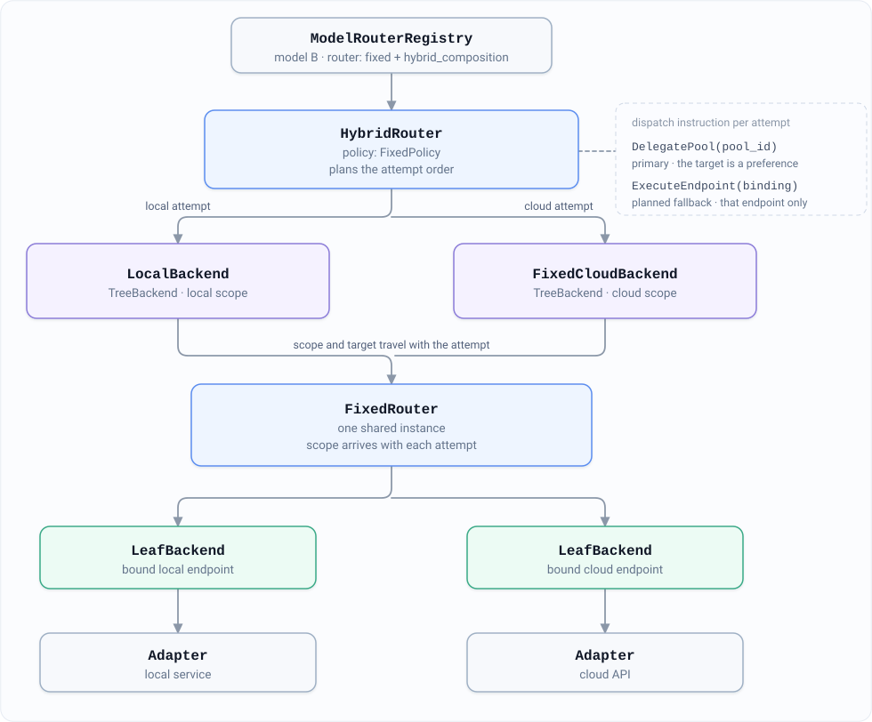

# Routing

A client asks for one public model id, and the gateway decides which upstream
endpoint serves it. It retries on another endpoint when one fails, stops
sending traffic to endpoints that are down, and keeps a conversation on the
endpoint whose prefix cache is warm.

This page covers the routing engine, its settings, how a router executes the
endpoint it chose, and how to add a strategy. [Configuration](configuration.md)
explains where configuration lives, and [Adding a New Model](adding-models.md)
explains a model entry and its `route:` list.

## Choosing a router per model

The routing file's `default_router:` names the strategy for models that do not
choose one. A model entry overrides it:

```json
{
  "models": [
    {
      "id": "<model-id>",
      "provider": "openai_compat",
      "router": "fixed",
      "route": [
        {
          "kind": "openai_compat",
          "weight": 0.7,
          "base_url": "http://localhost:8000/v1",
          "provider_model_id": "<served-model-name>"
        },
        {
          "kind": "openai_compat",
          "weight": 0.3,
          "base_url": "https://api.your-provider.example/v1",
          "api_key": "${YOUR_PROVIDER_API_KEY}",
          "provider_model_id": "<upstream-model-id>"
        }
      ]
    }
  ]
}
```

Two strategies are registered:

- **`fixed`** (the default): weighted random selection with fallback. Its only
  setting with an effect is `router_params.hybrid_composition` (default
  `false`), which turns on the experimental
  [hybrid composition](#hybrid-composition).
- **`routewise`**: cost- and latency-aware selection; see [RouteWise](#routewise).

`router_params:` holds the chosen strategy's settings. Admin refuses a catalog
whose `router:` names no registered strategy or whose `router_params:` holds a
key the strategy does not accept, naming the model and the problem; a stored
catalog with either problem registers none of its models at startup and logs
the same message. A `default_router` that names no strategy is refused with
the known strategies listed. `ENABLE_ROUTEWISE=true` makes `routewise` the
default when the routing file leaves `default_router` at `fixed`.

An alias shares its model's router, so a learning router sees the model's and
its aliases' traffic together.

## How `FixedRouter` picks an endpoint

For each request the `fixed` router narrows the model's routes in this order:

1. **Published route.** A model without a published, non-empty route gets a
   404.
2. **Modalities.** A request with non-text input keeps only routes whose
   `input_modalities` cover it, or raises `AllCircuitsOpenError` naming the
   modalities.
3. **Pin.** `X-Route-Pin: <provider-or-endpoint-id>` on `/v1/chat/completions`
   selects that route and disables fallback. The gateway honours it only on an
   administrator's request. A pin that matches nothing raises
   `ProviderPinError`.
4. **Admission.** Routes with weight `0`, an open circuit or a half-open test
   request in flight are dropped; if none is left, `AllCircuitsOpenError` names
   the endpoints considered. The model's offload route is held back unless it
   is the only one left (see [Queue-wait offload](#queue-wait-offload)).
5. **Affinity.** A live pin for this caller and model wins, unless its endpoint
   is backlogged (see [Session affinity](#session-affinity)).
6. **Weighted draw**, biased away from endpoints busy with prefill (see
   [Prefill-aware selection](#prefill-aware-selection)).

### Fallback

When the selected adapter raises, `FixedRouter` records the failure, drops the
caller's affinity pin and tries the remaining routes in declaration order. It
skips weight-`0` routes, routes that cannot take the request's modalities, and
routes the breaker refuses. The first success answers; if every route fails,
the primary error is raised with the attempt list attached. An offload route
comes next after a timed-out wait and last otherwise.

Fallback stops early in four cases:

| Case | Why | Log event |
|---|---|---|
| A pinned request never falls back. | The caller asked for one endpoint. | |
| A stream never falls back once bytes reached the client. | A second provider cannot be spliced into a committed SSE stream. | |
| Two routes refuse the request as malformed (400 or 422). | Otherwise every bad request reaches every route, canaries included. A context-window refusal does not count, nor does a 404 or 413, which usually describes the answering route. | `request_refusal_fallback_stopped` |
| An endpoint fails on the request (a 5xx or a dropped connection after the request left the gateway): at most two more routes are tried, and only the first failure is charged to a breaker. | A request that crashes one engine usually crashes the next; charging every route would let three such requests open every circuit of a model. | `endpoint_fault_fallback_stopped`, `repeat_fault_skip_breaker` |

Successful responses carry a `_routing` blob (`provider`, `base_url`,
`endpoint_id`, and `fallback` and `failed_attempts` after a fallback) so the
serving layer can attribute the request. Streams carry it in a synthetic chunk
(`routing_chunk()` in `apps/backend/routing/telemetry.py`) that the
completions router strips. Clients see neither.

## Endpoint health and circuit breaking

Every endpoint has a circuit breaker and a running average of its success
rate, shared by all routers in a process. The breaker opens after
`CIRCUIT_FAILURE_THRESHOLD` consecutive failures, or on a failure that leaves
the success rate below `CIRCUIT_MIN_AVAILABILITY`. After
`CIRCUIT_COOLDOWN_SECONDS` it lets one test request through: a success closes
it, a failure opens it again. While that request is in flight, a request with
no other route gets **503**.

One caller cannot open a circuit alone while the endpoint keeps serving
others. Callers are told apart by their affinity key (API key, inference grant
or anonymous address). After a caller's counted failure, its repeat failures
there are skipped (`caller_repeat_skip_breaker`) while the endpoint has served
someone else since, until it serves that caller again or
`CIRCUIT_CALLER_WINDOW_SECONDS` pass. An outage serves nobody, so every failure
in it counts. Failures with no caller, and credential rejections (401, 407),
always count.

Nor can one caller open a circuit when nobody else is calling, as on a local
model with one active user. A caller's failure that its request could have
caused, with no other caller failing there since the endpoint's last success or
within `CIRCUIT_CALLER_WINDOW_SECONDS`, extends the run of consecutive failures
but cannot open the circuit or lower the success rate
(`lone_caller_hold_breaker`). The next failure from anyone else opens it at
once. A refused or timed-out connection, a 429 on the gateway's account, a
credential rejection or a failure with no caller can always open it, so an
engine that is down still leaves rotation.

| Variable | Default | Meaning |
|---|---|---|
| `CIRCUIT_FAILURE_THRESHOLD` | `3` | Consecutive failures before the circuit opens. |
| `CIRCUIT_COOLDOWN_SECONDS` | `30` | Seconds before a half-open probe is admitted. |
| `CIRCUIT_MIN_AVAILABILITY` | `0.7` | Success-rate floor: a failure that leaves the endpoint's average below it opens the circuit. |
| `ROUTER_HEALTH_EWMA_ALPHA` | `0.1` | Smoothing factor for the availability EWMA. |
| `CIRCUIT_CALLER_WINDOW_SECONDS` | `60` | Seconds after one caller's counted failure during which its repeat failures are kept off the circuit, if another caller has been served since. Also how recent another caller's failure must be, unless it is part of the current run of failures, before one caller's failures can open the circuit. `0` stops telling callers apart: every failure counts and any failure can open the circuit. |

`GET /health/deep` shows each endpoint's availability and circuit state, and
marks an endpoint degraded as soon as a provider rejects the gateway's own
credential. State is per process: each worker keeps its own breakers. The
routing file's `health_check:` probe only reports; it never changes routing.

**For router authors:** `allow_request(endpoint_id)` is a pure predicate,
asked of every candidate. `begin_dispatch(endpoint_id)` is the commit, called
once for the chosen endpoint; it returns a `DispatchClaim`, or `None` when the
endpoint cannot take the request. Release the claim with `end_dispatch(claim)`
in a `finally`, as you release the prefill lease. Only that claim frees a
half-open test slot, and it expires after `CIRCUIT_COOLDOWN_SECONDS` if never
released.

## Routes excluded from selection

A route whose effective weight is zero is skipped by selection and every
fallback. `GET /health/deep` lists these under `route_exclusions`, one entry
per (model, endpoint) with the configured weight, the effective weight and the
`reasons`:

| Reason | Set by | Undone in |
|---|---|---|
| `weight_override` | a `provider_weight_overrides` row for that (model, endpoint) | admin console → routing weights |
| `provider_disabled` | a `disabled_providers` row for that provider label | admin console → providers |
| `route_disabled` | a `provider_route_states` row that disables or removes the route | admin console → routing (enable or restore the route) |
| `routing_yaml` | the local/remote split `RoutingManager` applies once at boot | the overlay's `ROUTING_POLICY` |
| `configured_zero` | `weight: 0` in the model registry | the overlay's `MODEL_CATALOG` |

`routing_yaml` appears only on a gateway without a database; with one, the
routing file's split never reaches the weights. Exclusions are also merged
into the `providers` map (`excluded_from_models`, `exclusion_reasons`) and do
not degrade the health verdict. A route zeroed at runtime is logged as
`route_weight_zeroed` (`WARNING`), and a re-weighted one as
`route_weight_overridden` (`INFO`), at boot and after every override reload.

## Prefill-aware selection

Weights balance request counts, but one large cache-miss prompt can occupy a
replica for minutes. `apps/backend/routing/prefill_load.py` tracks how many
un-cached prompt tokens each endpoint is prefilling and uses that to steer the
draw:

- Selection makes two weighted draws and keeps the endpoint with less prefill,
  once the heavier one has `ROUTING_PREFILL_INTERVENE_TOKENS` queued. Below
  that, weights decide alone.
- Very large prompts ("elephants") skip endpoints at the elephant limit, so
  they do not stack on one replica. If every endpoint is at the limit, the
  restriction is dropped; selection never refuses.
- The un-cached size is estimated from the caller's last prompt on that
  endpoint, so a warm continuation is not mistaken for a cold one. The hint is
  forgotten when the endpoint fails with a 5xx or no answer.
- A lease is taken when selection commits and released at the first token. It
  counts toward the affinity ceiling only after the request leaves the
  gateway, and never for more than the route's context window.

| Variable | Default | Meaning |
|---|---|---|
| `ROUTING_PREFILL_AWARE_ENABLED` | `1` | Set to `0` to fall back to a plain weighted draw. |
| `ROUTING_PREFILL_INTERVENE_TOKENS` | `50000` | Backlog at which load starts overriding the weighted draw. |
| `ROUTING_PREFILL_ELEPHANT_TOKENS` | `200000` | Estimated un-cached tokens at which a prompt counts as an elephant. |
| `ROUTING_PREFILL_ELEPHANT_LIMIT` | `1` | Concurrent elephants allowed per endpoint. |
| `ROUTING_PREFILL_AFFINITY_CEILING` | `150000` | Backlog above which a request skips its affinity pin. |
| `ROUTING_PREFILL_HINT_TTL_SEC` | `1200` | Lifetime of the per-(caller, endpoint) prompt-size memory. |

## Session affinity

`FixedRouter` pins each (caller, model) to the endpoint it last selected, for
five minutes on a sliding TTL (`AFFINITY_TTL_SECONDS` in `routers.py`), so a
conversation keeps a warm prompt cache. The caller is identified by
`derive_affinity_key()` in `apps/backend/serving/utils/request_ip.py`: the API
key's hash, else `grant:<grant_id>` for an inference grant, else
`ip:<bucket>` for an anonymous client (IPv6 folded to its `/64`). An anonymous
request whose client address cannot be resolved gets no pin. Chat completions,
Messages and embeddings publish the same key, so the endpoint pin and
`KeyPool`'s key binding agree.

- Any error from the pinned endpoint drops the pin; so does the endpoint
  becoming inadmissible.
- Above `ROUTING_PREFILL_AFFINITY_CEILING` of backlog, the request skips the
  pin but keeps it, and returns once the queue drains.
- A pin lasts at most `ROUTING_AFFINITY_MAX_AGE_SEC` (default `86400`; `0`
  turns the cap off) from when it was made, so weight changes reach busy
  callers too.
- State is per worker and does not survive a restart. `X-Route-Pin` bypasses
  affinity, and `ROUTING_AFFINITY_ENABLED=0` turns it off.

## Outbound concurrency

The gateway limits how many requests it keeps open against each provider label
and API key, and queues the rest. A route with several keys uses another key
with room before it queues. The limit starts at
`UPSTREAM_CONCURRENCY_INITIAL_LIMIT`, drops by one on each `429`, and rises by
one after every `UPSTREAM_CONCURRENCY_PROBE_SUCCESS_INTERVAL` successes, or on
the first success a minute after it last changed (a minute that doubles, up to
32 minutes, each time a rise draws a `429`). A request that waits longer than
`UPSTREAM_CONCURRENCY_ACQUIRE_TIMEOUT_SEC` fails over to the next route without
being charged to the breaker.

Self-hosted engines schedule their own work and bypass this limit. Declare a
route's `deployment_type` inside `route:` (the Admin Routing tab offers it
too):

| `deployment_type` | Treated as |
|---|---|
| `auto` (default) | self-hosted only for `localhost`, `127.0.0.1`, `0.0.0.0` and `host.docker.internal` |
| `self_hosted` | an engine you operate, including on a LAN or cluster DNS |
| `provider_api` | a provider account, even behind a loopback proxy |

It changes outbound admission and the hybrid composition's local/cloud split,
but not the URL, adapter, provider label, endpoint ID, credentials or RouteWise
resource type.

| Variable | Default | Meaning |
|---|---|---|
| `UPSTREAM_CONCURRENCY_ENABLED` | `true` | `false` disables the provider-key limit; a configured engine queue limit still applies |
| `UPSTREAM_CONCURRENCY_INITIAL_LIMIT` | `8` | Starting limit per provider key |
| `UPSTREAM_CONCURRENCY_MAX_LIMIT` | `64` | Highest the limit can rise |
| `UPSTREAM_CONCURRENCY_PROBE_SUCCESS_INTERVAL` | `100` | Successful responses between increases |
| `UPSTREAM_CONCURRENCY_ACQUIRE_TIMEOUT_SEC` | `30` | Longest a request waits for a slot before failing over |

## Queue-wait offload

A `fixed` model can reserve one route as its **offload route**, for requests
its other routes cannot start in time. Set it in the admin console
(**Routing → Queue offload**) or with
`PUT /admin/routing/offload-routes/{model_id}`: a route id, a wait in seconds,
and optionally an [engine queue limit](#engine-queue-limit) and a
[max offload input](#max-offload-input). It is stored in `site_settings` under
`model_offload_route:<model_id>`; the logic is in
`apps/backend/routing/offload.py`.

- The offload route takes no ordinary traffic: the draw, affinity and preferred
  targets skip it while another route is admissible.
- Every other attempt may wait at most the configured seconds for an outbound
  slot; then it leaves the queue and the offload route is tried next. Leaving
  the queue is safe because nothing was sent upstream.
- The offload route is also the last fallback, and the primary when nothing
  else is admissible. A request is offloaded at most once.
- If the offload route fails, the attempt cut short for it is retried once,
  last, with the full acquire timeout, so an offload never fails a request its
  own route would have served.

### Engine waits

The gateway cannot see an engine's own queue, so for a model with an offload
route, each streaming attempt on its other routes also waits at most the same
seconds for the first token (`apps/backend/routing/engine_wait.py`). An attempt
with no token in time is cancelled at the engine and offloaded. Output before
the first token is held back (up to 1 MB; past that the stream is committed and
`first_token_hold_cap_reached` is logged), so the client never sees the
abandoned attempt. The wait counts from when the request leaves the gateway and
includes prefill, so a model with very long prompts needs a longer wait.
Nothing is recorded against the engine. Once an adapter reports reading output
it holds back (an XML tool call, a `<think>` block, tool-call JSON), the
request waits as long as the engine needs. Non-streaming requests are not
watched.

A response served by the offload route carries `_routing.offload`:
`queue_wait`, `engine_wait` or `last_resort`. The request log keeps it, each
dispatch logs `route_offload`, and if the offload route fails, the marker stays
and `offload_endpoint_id` names it. The admin **Recent Requests** tab shows an
**Offloaded requests** table for the last 24 hours, served by
`GET /admin/recent-requests/offloads` (`days` defaults to `1`).

Nothing is offloaded for:

- a non-streaming request to an endpoint the gateway does not queue for: a
  self-hosted engine, or any provider while `UPSTREAM_CONCURRENCY_ENABLED=false`;
- a pinned request, or an attempt whose caller owns the candidate order
  (`allow_fallback` off, as in the hybrid composition);
- a prompt the offload route's `context_length` cannot fit, or one over the
  max offload input;
- `/v1/messages`, which keeps the offload route out of its single pick unless
  nothing else is eligible, but never offloads on a wait;
- `routewise` models and `fixed` models with `hybrid_composition: true`. The
  admin API refuses an offload route on either and refuses to switch a model
  that has one to `routewise`; a policy stored earlier is listed as inactive.

The wait must be positive and may exceed the acquire timeout, in which case it
bounds only the first token. The offload route needs an effective weight above
`0`: a weight override of `0`, a disabled provider or a disabled route turns
the offload off, and `GET /admin/routing/offload-routes` reports
`active: false` with an `inactive_reason`. Deleting a runtime route that is an
offload route is refused until the offload route is cleared.

### Engine queue limit

With an **engine queue limit** of N (`engine_queue_limit` in the API), each
self-hosted engine of the model is sent at most N streaming requests that have
not yet returned a first token; the rest wait in the gateway, in arrival order
(`EngineHold` in `apps/backend/serving/adapters/upstream_limiter.py`). A place
frees at the first token, so the limit caps how many requests wait or prefill
at the engine, not how many it runs. A held request that can be offloaded
leaves at the wait, before the engine sees it. One that cannot keeps its place
for up to `UPSTREAM_CONCURRENCY_ACQUIRE_TIMEOUT_SEC` and is then sent anyway:
the hold never fails a request. Non-streaming requests and provider routes are
not held.

Use `deployment_type: self_hosted` for an engine on another machine. That alone
neither sets a limit nor reserves an offload route, and reserving a route takes
it out of ordinary traffic; to share traffic between two routes, use weights.
A limit of `1` sends a request only once the previous one has started
answering; higher limits let the engine prefill several prompts at once. The
count is per gateway process, not a shared limit on the engine.

### Max offload input

With a **max offload input** of N tokens (`max_input_tokens` in the API), a
prompt estimated at more than N tokens is never sent to the offload route. It
waits as long as its own routes need, has no last resort, and gets `503` when
no other route is admissible. The estimate is the router's own
(`estimate_prefill_tokens` in `apps/backend/routing/prefill_load.py`): 4 bytes
of UTF-8 a token over everything sent upstream, plus 85 tokens per image and
200 per audio input. No tokenizer runs, so leave headroom when the limit stands
in for the offload route's context window. A pinned request goes where it is
pinned, whatever its size.

## RouteWise

`routewise` keeps the average time to first token as low as it can within a
cost budget: it prices every usable route, measures how fast each starts
answering, and picks the fastest mix for the money. Each model with
`router: routewise` gets its own `RouteWiseRouter`.

The algorithm is the MIT-licensed
[`llm-routewise`](https://github.com/HarvardMadSys/RouteWise) package, a
required dependency that does no network I/O and reads no credentials. The
design is described in *RouteWise: Latency--Cost Optimization for
Multi-Provider LLM Routing* (EuroSys '27). If the package is missing, the
backend still starts unless a model selects `routewise`. A registry you can run
unedited against two loopback providers is in
[`config/examples/models.routewise.json`](../../config/examples/models.routewise.json),
and {download}`config/examples/routewise-options.md <../../config/examples/routewise-options.md>`
describes every option.

**Measurements.** Until RouteWise has measured an endpoint, it sends everything
to the cheapest one. It learns from live traffic, from request logs replayed at
startup (`db_bootstrap_enabled`, on by default) and from its latency prober
(`routewise_probe_enabled`, off by default). A new deployment has no logs, so
turn the prober on. All RouteWise models in a worker share one probe limit, the
lowest `routewise_probe_max_concurrency` (default `1`) any of them sets, so two
models on one subscription do not probe it at once. A database lease
(`routewise_probe_leases`) keeps two workers from probing the same model.

**Configuration** splits by ownership:

- `router_params:` (per model) holds algorithm settings. The fields of
  `RouteWiseConfig` in `apps/backend/routing/routewise/config.py` are the
  complete list, with their defaults.
- Route entries hold resources: `provider_type: on_demand | quota |
  concurrency`, `pricing:`, `quota: {limit}` with a `quota_source:`,
  `concurrency: {limit}`, and `quota_pool:` / `concurrency_pool:` ids for
  routes that share one subscription.

A resource limit in `router_params:` fails at boot with a message naming its
route-level replacement. The retired keys `prefill_load_routing_enabled`,
`prefill_load_scale_ms_per_1k`, `prefill_load_max_penalty_ms` and
`latency_min_samples` are ignored with a warning; remove them. RouteWise does
not use prefill load.

**Hedging.** With `latency_hedge_mode: probability_target`, a primary that has
not started answering by a checkpoint may be raced against a backup. RouteWise
expects longer prompts to start later, so a long prefill alone does not
trigger a hedge. A primary that refuses the request as malformed or too long
gets no backup, and RouteWise stops re-solving after two malformed refusals.
The stream race's 60-second deadline counts as a failed attempt of each open
leg, but is charged to no breaker.

**Weights do not split traffic.** Every route with a weight above `0` is a full
candidate, so a 1% canary or a last-resort route becomes a peer. Set its weight
to `0` to keep it out (`optional: true` only controls whether a route with
unset environment is skipped). The admin console refuses to switch a model to
`routewise` while it has such a weighting, and the router logs
`routewise_route_weights_ignored` when one arrives another way.

**Quota sources.** `quota_source:` names a `provider`, `usage_label` and `unit`
that must match exactly a usage record from that provider's quota fetcher.
The gateway ships no fetchers: a backend extension registers one with
`register_quota_fetcher` (see
[Quota reporting](backend-extensions.md#quota-reporting)). A source that never
matches leaves the route unready and skipped, with no warning, so check a new
one against its fetcher. The [local quota example](../../config/examples/models.routewise.quota.json)
runs without a real supplier account. The `local` provider on admin-created
routes is a per-worker daily request counter (reset at server midnight, zero
after a restart), used when `route_metadata` sets `local_quota_fallback: true`
or the route and upstream providers differ. Any other window or limit needs a
real `quota_source`.

**Endpoint identity.** Latency profiles, availability and logs are keyed by
`{model_id}:{location}` (`registry._make_provider_id`): `local-{port}` for a
local host, otherwise a name from the hostname for generic kinds
(`api.minimax.io` → `minimax-api`) or `{kind}-api`. Changing the port or vendor
host renames the endpoint and restarts its latency profile.

**Startup.** A quota route needs a cost envelope calibrated from recent
traffic. Beside a non-quota route it starts masked; a model with only quota
routes raises `EnvelopeNotCalibratedError` and startup fails. RouteWise state
is per process, so a `quota` or `concurrency` route with `WEB_CONCURRENCY`,
`UVICORN_WORKERS` or `GUNICORN_WORKERS` above 1 also fails startup
(`stateful_providers_single_worker_only`, default true).

**Runtime tuning.** The model id is a query parameter because it may contain
`/`:

```text
GET    /admin/routewise/model-settings?model_id=<model-id>
PATCH  /admin/routewise/model-settings/{key}?model_id=<model-id>
DELETE /admin/routewise/model-settings/{key}?model_id=<model-id>
```

An alias reads and writes its canonical model's settings, and `DELETE` restores
the inherited value. `GET`/`PATCH /admin/routewise/settings` set the fallback
for models with neither an override nor a `router_params:` value.

## Reserving upstream keys for a tier

A provider key can be reserved for a role and above with its `min_role`
(`free`, the default, means no reservation; then `pro`, `internal`, `admin`).
The catalog's `required_role` decides what a user may call; a key's
`min_role` decides whose requests may spend it.

- `KeyPool` (`apps/backend/serving/adapters/key_pool.py`) hides reserved keys
  from callers below their role and offers the most reserved keys first.
- A caller with no usable key gets `KeyPoolExhausted`, and the router fails
  over. When the pool could still serve a higher tier, the refusal is
  `KeyPoolRoleRestricted` and does not count against the endpoint's health.
- `/v1/messages` picks the first adapter holding a key the caller may spend.
- Requests with no user identity (probes, warmups) are unrestricted.

Set reservations through the admin API; they apply immediately:

| Source | Endpoint | Where the reservation lives |
|---|---|---|
| Database (dashboard-added) | `POST /admin/provider-keys/{key_id}/min-role` | `provider_api_keys.min_role` |
| Environment (`<PROVIDER>_API_KEY`, registry `api_keys`) | `POST /admin/provider-keys/min-role-env` | `provider_env_key_min_roles`, keyed by the key's hash |

New keys accept `min_role` on `POST /admin/provider-keys`. An environment key's
reservation is keyed by hash, so it survives the key leaving rotation. When one
credential is configured twice, the most restrictive declaration wins.
`POST /admin/provider-keys/remove-env` (same body as disable) removes an
environment key for good: it blanks the saved settings that hold it and
refuses to re-enable it until it is configured again.

A catalog route that names a removed key setting (`api_key: ${DEEPSEEK_API_KEY}`
or an `api_keys` entry) keeps serving after a restart, on the provider's other
key settings and the Keys-tab keys present at boot. With neither, the route is
not registered, and a model left with no route is skipped; so is a model whose
key setting is blank in the environment or was never set. Remove returns 409
when a route would be left with no key (the provider has no other key, or the
route draws keys from a provider that does not own the setting): disable the
key instead, or add another first.

Reservations work only through `KeyPool`: on `openai_compat` and `openrouter`
routes, and single-key routes once a reservation applies. The `anthropic`,
`claude` and `gemini` adapters ignore them; gate those models with
`required_role`.

## Auto models

An auto model picks the model, not the endpoint. A client names a tier, such
as `auto-balance`, and each request goes to one of the tier's candidate models
and is served as a request for that model. Tiers are defined in an `auto:`
section of the model registry, next to `models:`:

```json
{
  "auto": {
    "default_profile": "balance",
    "session": {
      "idle_timeout_seconds": 1800,
      "max_sessions": 10000
    },
    "profiles": {
      "intelligence": {
        "candidates": [
          {
            "model": "<frontier-model>",
            "reasoning_effort": "high"
          },
          {
            "model": "<mid-model>",
            "reasoning_effort": "high"
          }
        ]
      },
      "balance": {
        "candidates": [
          {
            "model": "<mid-model>"
          },
          {
            "model": "<frontier-model>"
          }
        ]
      },
      "fast": {
        "candidates": [
          {
            "model": "<small-model>"
          },
          {
            "model": "<mid-model>",
            "reasoning_effort": "low"
          }
        ]
      }
    }
  }
}
```

Each profile is served as `auto-<name>`, and bare `auto` serves
`default_profile`. Auto models exist only while the `auto_mode_enabled` runtime
setting is on (off by default; the Settings tab offers it once the backend has
started with a valid `auto:` section). While it is off they get 404 and are not
listed.

**Which candidate serves:** the first one that can. A candidate is skipped when
the caller may not use its model, none of its endpoints is admitted, the
request needs tools or an input kind the model lacks, the prompt estimate
(times 1.25, plus `max_tokens`) does not fit its smallest context window, or
the model does not accept the candidate's `reasoning_effort` (applied only when
the request sets none).

**Sessions.** A conversation in its tool loop (the last message carries a tool
result) stays on its model until that model cannot serve; a new user turn ranks
the candidates again. A conversation is identified by the caller, the declared
session and its opening messages. Sessions live in process for
`idle_timeout_seconds`, at most `max_sessions` of them. When a session has
changed models and goes to an Anthropic-native endpoint, earlier thinking
blocks are removed first.

**Errors:** 404 when the caller can use none of the tier's models, 503 when a
usable model has no endpoint admitted, and 400 when every usable model is
unable to take the request.

**What the client sees** is always the auto model: in responses, stream chunks,
error messages, request history and grant ledgers. `/v1/models` lists an auto
model to callers who may use any of its models. The log row's `model_id` is the
model that served the request, with the decision in `metadata.auto`.

An invalid `auto:` section, or a tier named like a registered model, turns auto
off and logs why. The admin API refuses models named `auto` or
`auto-<anything>`, and the admin playground does not offer auto models.

## API endpoints

| Endpoint | Purpose |
|---|---|
| `GET /v1/models` | List published models. |
| `POST /v1/chat/completions` | Chat completion with automatic routing. |
| `GET /health` | Liveness: `status` for anyone; an administrator also sees the `routes_configured` count and each store's state. |
| `GET /health/deep` | Per-endpoint availability, circuit state, and `route_exclusions`. |
| `GET /routing` | Current weight distribution per model; for an administrator, also each route's `base_url` and the probe's `endpoint_health` map. |

These three status endpoints need no authentication. Anonymous callers see no
upstream addresses: `/routing` shows each route's `provider` and weight, and
`/health/deep` keys `providers` by `endpoint_id`. Only an administrator's JWT
or `ADMIN_TOKEN`, sent as `Authorization: Bearer ...`, shows base URLs and the
probe's `endpoint_health` map; any other credential gets the anonymous answer.
An `endpoint_id` can still reveal a local port or a host's first label
(`local-12003`, `10-api`); gate these paths at your reverse proxy if that is
too much.

Admin endpoints for routing, all behind admin authentication:

| Endpoint | Purpose |
|---|---|
| `GET /admin/routing` | The weight distribution, including unpublished routes. |
| `GET /admin/routing/provider-routes` | Every route the gateway serves, per model, tagged `source: yaml`, `override` or `runtime`; `.../{model_id}` for one model. |
| `POST /admin/routing/provider-route-models` | Create a runtime model with its first route. |
| `POST /admin/routing/provider-route-candidates/{model_id}` | Add a route to a model; `PATCH` and `DELETE` on `.../{model_id}/{route_id}` edit or remove it. |
| `PUT /admin/routing/provider-routes/{model_id}/{route_id}` | Retarget a registry route; `DELETE` restores the YAML route. |
| `PATCH /admin/routing/provider-route-states/{model_id}/{route_id}` | Disable or enable a route of either source; a disabled route keeps its weights but takes no request, retry, fallback or offload. |
| `PATCH /admin/routing/provider-route-batch/{model_id}/{route_id}` | Allow or forbid batch work on a route, or let it follow its locality (`null`): see [Which routes batch work may use](batches.md#which-routes-batch-work-may-use). |
| `POST` / `DELETE /admin/routing/provider-route-removals/{model_id}/{route_id}` | Delete a registry route from this deployment, or restore it; the catalog baseline is not changed. |
| `PUT` / `DELETE /admin/routing/weights/{model_id}/{endpoint_id}` | Set or clear a weight override. |
| `PATCH /admin/routing/provider-route-strategies/{model_id}` | Switch a model's router. |
| `GET /admin/routing/offload-routes` | Every model's offload route and whether routing applies it; `PUT` / `DELETE .../{model_id}` sets or clears one — see [Queue-wait offload](#queue-wait-offload). |
| `/admin/routewise/model-settings` | Per-model RouteWise tuning — see [RouteWise](#routewise). |

Each `POST` or `PUT` that changes a route has a `...-verifications` twin that
tries the upstream without saving. A save tries it the same way before it
writes anything, and the audit log records each check as
`routing.provider_routes.verify`, a failed one too.

A check sends the provider's stored API keys to the route's base URL. Verify
sends them only to the provider's own host or a host its routes already use.
A save that would send them to any other host answers `403` with `error_code`
`ADMIN_CONFIRMATION_REQUIRED` until the body carries the signed-in
administrator's `password`, or `""` when the account confirms with an
authenticator code or a fresh single sign-on instead; the console asks for it.
`ADMIN_TOKEN` cannot confirm, so it cannot point a route at such a host.

See
[Runtime configuration from the admin console](configuration.md#runtime-configuration-from-the-admin-console)
for the console tabs behind these endpoints.

## Where the code lives

Four pieces, all under `apps/backend/routing/`:

| Layer | Code | Responsibility |
|---|---|---|
| Deployment-wide weight strategy | `manager.py` + `strategies/weight.py` | Reads the routing file and rewrites each model's per-route weights from a local/remote split. Optional. |
| Per-model router selection | `model_router_registry.py` + `strategies/__init__.py` | Maps each model id to a `RouterProtocol` implementation, chosen by that model's `router:` field. |
| Routing | `routers.py` (`FixedRouter`), `routewise/`, `hybrid.py` (`HybridRouter`) | Chooses the endpoint for a request, admits it against capacity, walks the fallback order, and records endpoint health. |
| Execution | `backends.py` (public re-exports), `backends_contract.py`, `backends_leaf.py`, `backends_tree.py`, `backends_domains.py`, `backends_routewise.py` + `dispatch.py` | Runs the one endpoint the router already chose, or delegates the request to a pool that chooses inside its own declared range. |

## Router types and execution boundaries

At startup, `apps/backend/serving/servers/bootstrap.py` registers the catalog
into one shared `FixedRouter`, applies the optional `RoutingManager`, and
builds a `ModelRouterRegistry` over the same route table. It builds every
model's router at boot, so a bad strategy name or `router_params:` fails at
startup. The current design is in the
[composable routing design record](https://github.com/HarvardMadSys/hybridInference/blob/dev/docs/agents/specs/2026-09-14-composable-hybrid-routing-design.zh.md).


*Router contracts. Dashed boxes and edges are not built yet.*

`FixedRouter` and `RouteWiseRouter` are peer implementations of
`RouterProtocol`, and future Greedy or Nimbus routers belong beside them. Each
owns its own selection, admission, retries and feedback. Once a router picks an
endpoint, it executes it through a `LeafBackend`, which calls that one adapter
with the adapter's own signature. `HybridRouter` selects nothing itself: it
hands each attempt to a pool, a `TreeBackend` that holds a scoped router (which
can be RouteWise).

### Leaves, pools, and dispatch instructions

A router binds its choice in an `EndpointBinding`: the endpoint id, model,
pool, a diagnostic `generation` and the adapter itself. Execution never looks
the target up again, so an admin route edit cannot redirect a request in
flight. Each hedge leg gets its own leaf, and RouteWise refuses a binding whose
adapter has been replaced before it reserves capacity.

The router that chose the endpoint keeps all accounting: the admission claim,
the prefill lease, retry and hedge bookkeeping, `_routing` metadata and the
feedback to `record_observation()`. A leaf keeps no second copy.

A pool takes one of two instructions (`apps/backend/routing/dispatch.py`):

| Instruction | Permission | Pool behavior |
|---|---|---|
| `ExecuteEndpoint(binding)` | Execute exactly the bound endpoint. | `TreeBackend` accepts a binding within its model and endpoint scope. The child router admits that target and executes it through a leaf, with re-selection and fallback disabled. |
| `DelegatePool(pool_id)` | Select inside the named pool. | `TreeBackend` delegates selection, admission, retries, and hedging to its scoped router. |

`check_dispatch()` refuses a wrong pool, an excluded model or an out-of-scope
binding before any upstream I/O, as a composition error: no fallback and no
provider failure. A leaf cannot carry out `DelegatePool`. `LocalBackend` and
`FixedCloudBackend` narrow `RoutingRequestOptions.endpoint_scope` before
calling the shared router, and `RouteWiseCloudBackend` binds a
`RouteScopeView` (`route_scope.py`) that keeps the child's selection, retries,
hedges and probes in range. An empty scope intersection is refused, never
treated as unrestricted. A pool with no capacity raises
`TargetUnavailableError`, and `HybridRouter` tries the next attempt; if every
attempt is refused before reaching an upstream, the request gets 503 (as an SSE
error once headers are sent).

### Hybrid composition

The hybrid composition is an opt-in, experimental `HybridRouter` for a `fixed`
model with both local and cloud candidates:

```yaml
router: fixed
router_params:
  hybrid_composition: true
```

Without both kinds of candidate the model keeps the shared `FixedRouter`, and
pinned requests (`X-Route-Pin`, the admin playground) always use it. Local
means what outbound admission means: a route's `deployment_type`, or its
hostname under `auto`. A composition root can instead pass `local_scope` or
`local_ownership` to `apps/backend/serving/servers/hybrid_composition.py`.



*Fixed composition: two scoped pools, one shared FixedRouter.*

`HybridRouter` plans attempts with `FixedPolicy`. The primary attempt is a
`DelegatePool`, so the pool may choose inside its scope; every planned fallback
is an `ExecuteEndpoint`, so the child router cannot reorder the plan. The
composition is not the default because its affinity updates, its re-selection
after a refused primary claim and its fallback circuit timing are not yet
proven equivalent to `FixedRouter`
([#1457](https://github.com/HarvardMadSys/hybridInference/issues/1457)).

A planned extension puts a Greedy router in front, owning local admission, with
a cloud-scoped RouteWise under a `TreeBackend` choosing among cloud endpoints.
The pool side exists (`backends_tree.py`, and the transitional
`RouteWiseCloudBackend` in `backends_routewise.py`), and
`HybridFixedRouterFactory` accepts a `cloud_backend` builder, but no
configuration reaches it: `GreedyRouter` and `NimbusRouter` are not registered.
Separate scopes do not divide physical capacity; sharing quota or concurrency
across router instances is not implemented (#1457).

## Adding a routing strategy

A strategy is a class that satisfies `RouterProtocol`, registered under a name
a model's `router:` field can select.

### 1. Understand the contract

`RouterProtocol` (`apps/backend/routing/protocols.py`) is a runtime-checkable
`Protocol` with four members:

```python
async def chat_completion(
    self,
    model_id: str,
    messages: list[dict[str, Any]],
    *,
    routing_options: RoutingRequestOptions | None = None,
    **params: Any,
) -> dict[str, Any]: ...

def stream_chat_completion(
    self,
    model_id: str,
    messages: list[dict[str, Any]],
    *,
    routing_options: RoutingRequestOptions | None = None,
    **params: Any,
) -> AsyncIterator[Any]: ...

def record_observation(self, obs: RoutingObservation) -> None: ...

def get_provider_status(self) -> dict[str, dict[str, Any]]: ...
```

`RoutingRequestOptions` carries router-owned controls that must never reach a
provider adapter: `pin_provider` (a hard pin that disables fallback),
`preferred_endpoint_id` (mandatory only with `require_target`),
`endpoint_scope`, `allow_fallback`, `bound_endpoint`, `required_modalities`
and `affinity` (whether to follow and update the caller's pin).

`RoutingObservation` (`routers.py`) reports a completed request: endpoint id,
TTFT, total latency, token counts, success, `status_code` for a failure,
`uncharged` for a failure no endpoint is charged with, and the
`strategy_metadata` the strategy filled in. A stateless strategy ignores it.
A learning one should take only what the attempt shows about its endpoint, as
RouteWise does: it measures time to first content from the attempt's own
dispatch, ignores total latency, and leaves client errors (a 4xx other than
408, 429, 401 and 407) and uncharged failures out of its latency profiles. An
uncharged failure means the gateway refused the attempt before sending it, so
RouteWise re-solves over the other candidates.

Two optional capabilities:

- `RouteTableRefreshable`: implement `refresh_route_table()` if your router
  derives state from the route table; `ModelRouterRegistry.refresh_route_tables()`
  calls it after an admin route change.
- `ManagedRouter` (`routers.py`): implement `async start()` / `async stop()`
  if your router owns background tasks. Bootstrap drives their lifecycle.

### 2. Get the routes

The registry builds your router, then calls `attach_route_table(route_table)`
on it. A router without that method sees no routes at all. The object
satisfies `RouteTableView` (`apps/backend/routing/route_table.py`):

```python
def iter_effective_routes(self) -> tuple[EffectiveRoute, ...]: ...
def canonical_id(self, model_id: str) -> str: ...
```

Each `EffectiveRoute` is a frozen `(route_key, canonical_model_id, adapters)`
triple, where `adapters` holds `(adapter, weight)` pairs with weight overrides
and provider disables applied. Snapshot it; do not hold a lock across a
dispatch.

### 3. Write the strategy module

Strategies live in `apps/backend/routing/strategies/`, one module each,
exporting a router class and a Pydantic params model. A complete round-robin
strategy, saved as `apps/backend/routing/strategies/round_robin.py`:

```python
"""Round-robin routing strategy."""

from __future__ import annotations

import threading
from typing import TYPE_CHECKING, Any

from pydantic import BaseModel

from routing.backends import LeafBackend
from routing.dispatch import binding_for_adapter
from routing.endpoint_health import EndpointHealthRegistry
from routing.endpoints import endpoint_id_for_adapter
from routing.strategies import register_strategy

if TYPE_CHECKING:
    from collections.abc import AsyncIterator

    from routing.protocols import RoutingRequestOptions
    from routing.route_table import RouteTableView
    from routing.routers import RoutingObservation
    from serving.adapters.base import BaseAdapter


class RoundRobinParams(BaseModel):
    """Parameters accepted under ``router_params:`` for this strategy."""

    model_config = {"extra": "forbid"}

    skip_open_circuits: bool = True


class RoundRobinRouter:
    """Cycle through a model's routes in declaration order."""

    def __init__(
        self,
        params: RoundRobinParams | None = None,
        *,
        health_registry: EndpointHealthRegistry | None = None,
    ) -> None:
        self.params = params or RoundRobinParams()
        self._health = health_registry or EndpointHealthRegistry()
        self._lock = threading.Lock()
        self._cursor: dict[str, int] = {}
        self._routes: dict[str, tuple[BaseAdapter, ...]] = {}
        self.route_table: RouteTableView | None = None

    # -- registry binding -------------------------------------------------
    def attach_route_table(self, route_table: RouteTableView) -> None:
        """Bind the shared read-only route table after construction."""
        self.route_table = route_table
        self.refresh_route_table()

    def refresh_route_table(self) -> None:
        """Rebuild route-derived state after an admin route change."""
        table = self.route_table
        if table is None:
            return
        rebuilt: dict[str, tuple[BaseAdapter, ...]] = {}
        for route in table.iter_effective_routes():
            rebuilt[route.route_key] = tuple(
                adapter for adapter, weight in route.adapters if weight > 0
            )
        with self._lock:
            self._routes = rebuilt

    # -- selection --------------------------------------------------------
    def _next_adapter(self, model_id: str) -> BaseAdapter | None:
        with self._lock:
            adapters = self._routes.get(model_id, ())
            if not adapters:
                return None
            start = self._cursor.get(model_id, 0)
            for offset in range(len(adapters)):
                index = (start + offset) % len(adapters)
                adapter = adapters[index]
                if self.params.skip_open_circuits and not self._health.allow_request(
                    endpoint_id_for_adapter(adapter)
                ):
                    continue
                self._cursor[model_id] = index + 1
                return adapter
        return None

    # -- RouterProtocol ---------------------------------------------------
    async def chat_completion(
        self,
        model_id: str,
        messages: list[dict[str, Any]],
        *,
        routing_options: RoutingRequestOptions | None = None,
        **params: Any,
    ) -> dict[str, Any]:
        """Route a non-streaming chat completion request."""
        adapter = self._next_adapter(model_id)
        if adapter is None:
            raise ValueError(f"No route available for model {model_id}")
        leaf = LeafBackend.for_binding(binding_for_adapter(adapter, model_id=model_id))
        endpoint_id = leaf.endpoint_id
        self._health.ensure(endpoint_id)
        try:
            response = await leaf.chat_completion(messages, **params)
        except Exception as exc:
            self._health.record_failure(endpoint_id, reason="chat_exception", exc=exc)
            raise
        self._health.record_success(endpoint_id)
        response.setdefault(
            "_routing",
            {
                "provider": adapter.config.provider,
                "base_url": adapter.config.base_url,
                "endpoint_id": endpoint_id,
            },
        )
        return response

    async def stream_chat_completion(
        self,
        model_id: str,
        messages: list[dict[str, Any]],
        *,
        routing_options: RoutingRequestOptions | None = None,
        **params: Any,
    ) -> AsyncIterator[str]:
        """Route a streaming chat completion request."""
        adapter = self._next_adapter(model_id)
        if adapter is None:
            raise ValueError(f"No route available for model {model_id}")
        leaf = LeafBackend.for_binding(binding_for_adapter(adapter, model_id=model_id))
        endpoint_id = leaf.endpoint_id
        self._health.ensure(endpoint_id)
        try:
            async for chunk in leaf.stream_chat_completion(messages, **params):
                yield chunk
        except Exception as exc:
            self._health.record_failure(endpoint_id, reason="stream_exception", exc=exc)
            raise
        self._health.record_success(endpoint_id)

    def record_observation(self, obs: RoutingObservation) -> None:
        """Ignore observations: this strategy keeps no online-learning state."""
        return None

    def get_provider_status(self) -> dict[str, dict[str, Any]]:
        """Return endpoint health and circuit state."""
        return self._health.snapshot()


register_strategy("round_robin")((RoundRobinRouter, RoundRobinParams))
```

Points to copy:

- **`extra="forbid"` on the params model**, so a typo in `router_params:`
  fails at boot instead of silently using a default.
- **Accept `health_registry=`** (or `**kwargs`). The registry requires it when
  it passes `RouterBuildDependencies` and raises `TypeError` otherwise; sharing
  the process registry makes one endpoint's circuit visible to every router.
- **Name the first parameter `params`.** `build_router` calls
  `router_cls(params=validated, ...)`.
- **Use `endpoint_id_for_adapter`.** Endpoint ids key health, latency
  profiling and log attribution; your own would split them.
- **Execute through a leaf.** Bind with `binding_for_adapter()`, build the leaf
  with `LeafBackend.for_binding()` and call it with the adapter's arguments,
  keeping admission, health and `_routing` metadata in your router. When
  delegating to a pool, send `ExecuteEndpoint` only for an exact target you
  resolved, else `DelegatePool`, and pass the binding and target/fallback
  controls in `RoutingRequestOptions`.

### 4. Register it at import time

Registration is an import side effect. Import the module at the *bottom* of
`apps/backend/routing/strategies/__init__.py`, beside the existing imports;
strategy modules import `routing.routers` at their top, so a top-of-file import
here would be a cycle:

```python
from routing.strategies import fixed  # noqa: F401
from routing.strategies import round_robin  # noqa: F401
```

If your strategy needs an optional package, guard the import and call
`register_missing_strategy(name, reason)` in the `except ImportError:` branch,
as `routewise` does. Selecting it then fails configuration validation with your
message instead of breaking backend import.

### 5. Select it

Per model, in the model registry:

```json
{
  "models": [
    {
      "id": "<model-id>",
      "router": "round_robin",
      "router_params": {
        "skip_open_circuits": true
      }
    }
  ]
}
```

Or deployment-wide, in the routing file:

```json
{
  "default_router": "round_robin"
}
```

`RoutingManager.apply()` rewrites weights only when the effective
`default_router` is `fixed`; otherwise each model's `route:` weights stay as
written.

### 6. Test it

Add your class to `tests/unit/routing/test_router_contract.py`, the contract
every serving router must satisfy; `test_strategies.py` covers registration,
params validation and the dependency check. `isinstance(router, RouterProtocol)`
works because the protocol is `@runtime_checkable`.

```bash
uv run pytest tests/unit/routing -q
```
